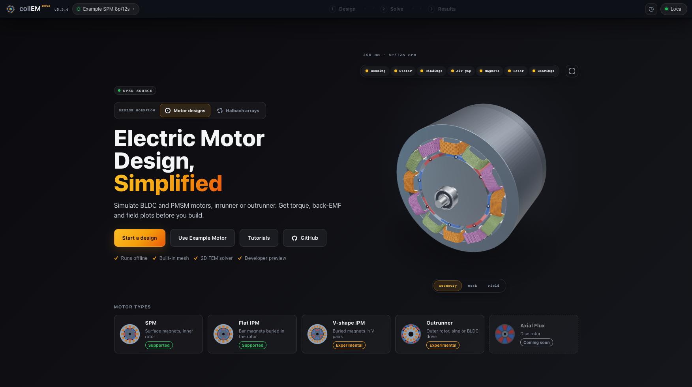

# coilEM

coilEM is an open-source app for designing electric motors. Draw a motor, mesh
it, solve it with the built-in 2D finite-element solver, and read off torque,
back-EMF and field plots. It runs on your computer, with no account and
nothing sent anywhere.

Website: [coilem.com](https://coilem.com)



## Install

coilEM is on PyPI as `coilem`. Install it with [uv](https://docs.astral.sh/uv/)
and start it:

```sh
uv tool install coilem
coilem
```

`coilem` opens [http://127.0.0.1:2645](http://127.0.0.1:2645) in your browser.
Press Ctrl+C in its terminal to stop it. To try it once without installing,
run `uvx coilem`. Nothing else is needed: the wheel includes the solver and the
UI, and uv fetches a compatible Python (3.11 to 3.15) if you do not have one.

If you do not have uv yet, install it and open a new terminal:

```sh
curl -LsSf https://astral.sh/uv/install.sh | sh
```

On Windows PowerShell:

```powershell
powershell -ExecutionPolicy ByPass -c "irm https://astral.sh/uv/install.ps1 | iex"
```

Supported platforms: macOS 12 or newer on Apple silicon, macOS 10.15 or newer
on Intel, 64-bit Windows, and x86_64 Linux with glibc 2.27 or newer. Linux and
Windows on ARM are not supported yet. On Debian and Ubuntu, install the
libraries the mesher needs first:

```sh
sudo apt-get install libglu1-mesa libgl1 libx11-6 libxcursor1 libxext6 libxfixes3 libxft2 libxinerama1 libxrender1 libfontconfig1 libgomp1
```

Upgrade with `uv tool upgrade coilem`; remove it with `uv tool uninstall coilem`.
If `coilem` is not found after installing, run `uv tool update-shell` and open
a new terminal. [The `coilem` launcher](docs/RUNTIME_SETTINGS.md#the-coilem-launcher)
covers ports and options.

## What you can do

Choose **Use Example Motor**, or one of the motor types on the first screen,
and follow Design → Solve → Results. The
[Getting started guide](docs/GETTING_STARTED.md) walks through it.

- **Design** inner-rotor and outer-rotor (outrunner) surface-magnet motors, and
  flat-buried and V-shape IPM motors, with concentrated or distributed
  windings. See the motor in 2D and 3D as you edit it.
- **Drive** it with sinusoidal current, or with ideal six-step (BLDC)
  commutation for surface-magnet motors.
- **Solve** for loaded torque, phase and line back-EMF, flux linkage and
  cogging torque, then play the field back as the rotor turns.
- **Go further** with d/q flux linkage and inductances, torque–speed and
  efficiency maps, copper and iron loss, and magnet temperature.
- **Keep your work**: saved runs, side-by-side comparison, and PDF and CSV
  exports.
- **Learn**: ten solver-backed lessons, and workspaces for cylindrical and
  linear [Halbach arrays](docs/HALBACH_ARRAY.md).

## How far to trust it

coilEM is a developer preview. Every release is compared with FEMM, a
reference 2D finite-element solver, on a fixed set of benchmark motors: mean
torque must agree within 8% and back-EMF within 10%.

| Motor | Status |
| --- | --- |
| Inner-rotor SPM, concentrated or two-layer distributed winding | Checked against FEMM |
| Flat-buried IPM, concentrated winding | Checked against FEMM |
| V-shape IPM | Experimental |
| Outrunner (outer-rotor SPM), concentrated winding | Checked against FEMM with sinusoidal current; six-step drive is Experimental |

Of the other outputs, phase resistance and copper loss are checked against hand
calculations. Cogging torque, d/q quantities, the maps, iron loss, efficiency
and magnet temperature are experimental, and the app, PDF and CSV label each
one. Agreement with FEMM is agreement between two solvers, not a hardware
measurement.

Things the model leaves out:

- It is 2D: end effects and skew are not modelled.
- Six-step drive is the ideal commanded current, without PWM, switching, ESC dynamics or thermal behavior.
- There is no thermal solver. Winding and magnet temperatures are inputs.
- Losses omit magnet and rotor eddy currents, AC copper loss and the inverter.
- Each rotor position is meshed separately, so check mesh and angle settings
  before reading meaning into small torque-ripple or cogging differences.

[Validation](docs/VALIDATION.md) has the full scope and limits, and the
[benchmark index](benchmarks/README.md) has every qualification record.

## Check it yourself

Run the same benchmark suite on your own computer:

```sh
coilem benchmark --quick
```

That solves one complete-grid case in each of the six phases and compares it
with the frozen reference that ships with coilEM. Drop `--quick` for all 69
cases, or use `--list` to see the selection and recorded runtime estimates.
It needs no Git, Rust, Node.js or FEMM. See
[benchmark protocol 1.10.0](benchmarks/af-v1.10/README.md).

## Build from source

To work on coilEM itself you need Python 3.11 to 3.15, Node.js 24 with npm,
and stable Rust (1.84 or newer). On Debian and Ubuntu, install the Linux
libraries above first.

macOS or Linux:

```bash
python3 -m venv .venv
.venv/bin/python -m pip install -r requirements.lock
.venv/bin/python -m pip install -e ".[dev]"
cargo build --release --locked --manifest-path solvers/magneto2d/Cargo.toml
.venv/bin/python -m uvicorn backend.public_main:app --host 127.0.0.1 --port 8000
```

Windows PowerShell:

```powershell
py -3.11 -m venv .venv
.\.venv\Scripts\python.exe -m pip install -r requirements.lock
.\.venv\Scripts\python.exe -m pip install -e ".[dev]"
cargo build --release --locked --manifest-path solvers/magneto2d/Cargo.toml
.\.venv\Scripts\python.exe -m uvicorn backend.public_main:app --host 127.0.0.1 --port 8000
```

Then, in a second terminal:

```sh
cd frontend
npm ci
npm run dev
```

Open [http://127.0.0.1:5173](http://127.0.0.1:5173). Keep the backend bound to
loopback.

## More

- [Release notes](RELEASE_NOTES.md) and [release status](PUBLICATION_STATUS.md).
  This is coilEM 0.5.7, with the Magneto2D 0.5.0 solver.
- [Architecture](docs/ARCHITECTURE.md), the [Magneto2D solver](docs/MAGNETO2D.md)
  and [solver convergence](docs/SOLVER_CONVERGENCE.md).
- [Materials](MATERIALS.md), [runtime settings](docs/RUNTIME_SETTINGS.md) and
  [where saved runs live](docs/local_solve_workspace.md).
- Design files use `.coilem`; older `.openem` files still open.
- Report bugs through [Support](SUPPORT.md), and vulnerabilities privately
  through [Security](SECURITY.md).

coilEM is licensed under AGPL-3.0-or-later. See [LICENSE](LICENSE), the
[third-party notices](THIRD_PARTY_NOTICES.md) and the
[trademark terms](TRADEMARKS.md).
