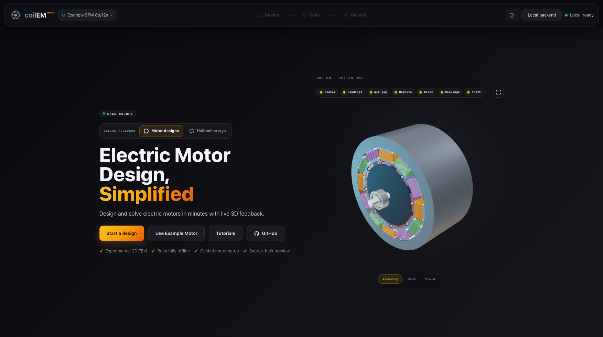

# coilEM — local electromagnetic design

coilEM is an open-source application for exploring electric motors and magnetic
fields. Edit a motor, inspect its geometry and mesh, run the bundled Magneto2D
solver, and compare saved results with field playback and PDF/CSV exports.
Everything runs on your computer.

Website: [coilem.com](https://coilem.com)

The latest complete benchmark reports, [v1.7](benchmarks/macos-rc-20261013-1fac3a1/README.md) on macOS and
[v1.8](benchmarks/windows-rc-20261013-1fac3a1/README.md) on Windows, measure the selected A/B/C/D matrix on
coilEM 0.3.0 (`1fac3a1`): 29 PASS, one planned unsupported Prius fixture and
42/42 BLDC gates on both platforms. The two platforms agree on every verdict
and gate status. They run fresh Magneto2D fields against frozen, data-only
FEMM references; no new FEMM solves were executed. The
[benchmark index](benchmarks/README.md) retains earlier runs, the compiled
v1.2 selection, archived runs and the scoped preview qualification record.



**Developer preview:** the published [A/B/C/D benchmark report
v1.1](benchmarks/main-20261009-bad71d9/benchmark_report.md) qualifies these
tested combinations against matched FEMM references, and reports
[v1.7](benchmarks/macos-rc-20261013-1fac3a1/README.md) and [v1.8](benchmarks/windows-rc-20261013-1fac3a1/README.md) confirm that every qualified
fixture still passes on coilEM 0.3.0, on macOS and Windows:
- SPM with concentrated windings, under sinusoidal or ideal six-step current;
- SPM with two-layer distributed windings, under sinusoidal current; and
- flat-buried IPM with concentrated windings, under sinusoidal current.

V-shape IPM and untested combinations, such as six-step with distributed
windings, are experimental. See [Validation](docs/VALIDATION.md) for the
qualified scope and its limits.

## Install

coilEM is published on PyPI as `coilem`. Install it with
[uv](https://docs.astral.sh/uv/), then start it:

```sh
uv tool install coilem
coilem
```

`coilem` starts the app on your computer and opens
[http://127.0.0.1:2645](http://127.0.0.1:2645) in your browser. Press Ctrl+C in
its terminal to stop it. To try coilEM once without installing it, run
`uvx coilem`. uv downloads a compatible Python (3.11 to 3.15) if you do not
have one, and nothing else is needed: each wheel includes the Magneto2D solver
and the built UI.

If you do not have uv yet, install it first, then open a new terminal:

```sh
curl -LsSf https://astral.sh/uv/install.sh | sh
```

On Windows PowerShell:

```powershell
powershell -ExecutionPolicy ByPass -c "irm https://astral.sh/uv/install.ps1 | iex"
```

| Platform | Requirement |
| --- | --- |
| macOS on Apple silicon | macOS 12 or newer |
| macOS on Intel | macOS 10.15 or newer |
| Linux x86_64 | glibc 2.27 or newer (for example Ubuntu 18.04, Debian 10, RHEL 8) and the OpenGL and X11 libraries Gmsh needs: `sudo apt-get install libglu1-mesa libgl1 libx11-6 libxcursor1 libxext6 libxfixes3 libxft2 libxinerama1 libxrender1 libfontconfig1 libgomp1` on Debian and Ubuntu |
| Windows x64 | 64-bit Windows |

Linux and Windows on ARM are not supported yet. CI tests the installed wheel
on macOS 15 (Apple silicon and Intel), Ubuntu 22.04 and Windows Server 2022
with Python 3.11 to 3.15.

Upgrade with `uv tool upgrade coilem` and remove it with
`uv tool uninstall coilem`. Saved runs stay in your
[user-data folder](docs/local_solve_workspace.md) after an uninstall. If
`coilem` is not found after installing, run `uv tool update-shell` and open a
new terminal. `pipx install coilem` also works when pipx runs on Python 3.11
to 3.15. [The `coilem` launcher](docs/RUNTIME_SETTINGS.md#the-coilem-launcher)
describes ports and options.

## Start from source

To work on coilEM itself, build it from a checkout instead.
You need Python 3.11 to 3.15, Node.js 24 with npm, and stable Rust with Cargo
(the locked `faer` dependency requires Rust 1.84 or newer). Use a fresh checkout and virtual environment. On Ubuntu/Debian, install the system
libraries Gmsh needs first: `sudo apt-get install libglu1-mesa libgl1 libx11-6 libxcursor1 libxext6 libxfixes3 libxft2 libxinerama1 libxrender1 libfontconfig1 libgomp1`.

Windows PowerShell:

```powershell
py -3.11 -m venv .venv
.\.venv\Scripts\python.exe -m pip install -r requirements.lock
.\.venv\Scripts\python.exe -m pip install -e ".[dev]"
cargo build --release --locked --manifest-path solvers/magneto2d/Cargo.toml
.\.venv\Scripts\python.exe -m uvicorn backend.public_main:app --host 127.0.0.1 --port 8000
```

macOS or Linux:

```bash
python3 -m venv .venv
.venv/bin/python -m pip install -r requirements.lock
.venv/bin/python -m pip install -e ".[dev]"
cargo build --release --locked --manifest-path solvers/magneto2d/Cargo.toml
.venv/bin/python -m uvicorn backend.public_main:app --host 127.0.0.1 --port 8000
```

In a second terminal:

```sh
cd frontend
npm ci
npm run dev
```

Open [http://127.0.0.1:5173](http://127.0.0.1:5173), choose **Use Example
Motor**, and follow Design → Solve → Results. The [Getting started
guide](docs/GETTING_STARTED.md) explains the example, solve settings and exports.
The backend must stay bound to loopback.

Contributors can also try the packaged launcher from a checkout. Run
`python -m pip install .` in a separate virtual environment; this builds the UI
and Magneto2D, so it still needs Node.js and Cargo. Then run `coilem`: it
serves the UI and API together and opens `http://127.0.0.1:2645`. See
[the `coilem` launcher](docs/RUNTIME_SETTINGS.md#the-coilem-launcher).

## What you can explore

- Radial-flux SPM and IPM (flat-buried and V-shape) motor geometry, native
  Gmsh meshes, sinusoidal current, and ideal wye-connected 120-degree six-step
  excitation for SPM.
- Loaded torque, phase and line Back-EMF, field plots, and harmonic spectra.
- Preview, Standard and High accuracy mesh/solve presets. These names describe
  resolution and sampling; they do not certify accuracy.
- Saved runs, comparison, project save/reopen, PDF, CSV and replay downloads.
- Solver-backed electromagnetics lessons and cylindrical and linear
  [Halbach workspaces](docs/HALBACH_ARRAY.md).

## Limits to understand

Qualification means agreement with FEMM, a reference 2D finite-element solver,
on the measured benchmark fixtures: mean torque within 8%, Back-EMF fundamental
and peak within 10%, plus fourteen six-step gates for BLDC. It covers only the
tested combinations listed above, with M350-50A steel. One of six V-shape IPM
fixtures is YELLOW against FEMM, so V-shape results are experimental. Cogging, THD, airgap harmonics, losses and
thermal behavior are not covered. It is not a hardware measurement.

Motor sweeps use per-angle meshes, with symmetry-based reuse where applicable,
without a sliding-band interface. Mesh changes can introduce numerical noise
into torque ripple and cogging. Check mesh and angular convergence before
interpreting small variations. A dedicated cogging result view is not included.
Six-step excitation models ideal commanded currents, without PWM, switching,
ESC dynamics or thermal behavior. See [Release notes](RELEASE_NOTES.md) and
[Materials](MATERIALS.md).

The application is **coilEM 0.3.1** and the solver is **Magneto2D 0.3.3**.
There are no accounts, hosted services or telemetry in this distribution.
Elmer is an optional development-only lane; see [its setup](docs/ELMER.md).

## Reproducibility and contributing

Run the versioned A/B/C/D suite (SPM, IPM, Distributed Winding and BLDC) on
your own computer with `coilem benchmark`, or `coilem benchmark --quick` for one
case per phase in about 5 minutes. It solves each case with the installed
Magneto2D and grades it against the frozen FEMM reference that ships with
coilEM. It then checks that the result matches the [published record](benchmarks/records/README.md)
for your platform, and writes a shareable report with no local paths. It needs
no Git, Rust, Node.js or FEMM. From a checkout, `python -m tools.run_benchmarks
--out-dir ../benchmark-output/my-run --pdf` runs the same suite with the
developer options. See the [benchmark commands, reference compatibility and
version policy](benchmarks/abcd-v1.3/README.md).

The public Magneto2D path ignores inherited numerical solver switches. It derives
native options from the request and records its environment policy and options
in new motor results. [Runtime settings](docs/RUNTIME_SETTINGS.md) lists public
configuration names. New design files use `.coilem`; existing `.openem` files
remain compatible with the same JSON project format.

Completed runs live outside the checkout in your OS user-data directory and
retain requests, results and hashes. See [local storage](docs/local_solve_workspace.md).
The root snapshot manifest records the original source export, listed public
patches, and current file hashes. It is an
integrity record, not evidence of numerical accuracy.

See [Architecture](docs/ARCHITECTURE.md), [Magneto2D](docs/MAGNETO2D.md),
[the public API boundary](docs/PUBLIC_BOUNDARY.md), and
[Validation](docs/VALIDATION.md) for checks and numerical limitations.
Report bugs through [Support](SUPPORT.md), and vulnerabilities privately through
[Security](SECURITY.md). Source is licensed under AGPL-3.0-or-later; see
[LICENSE](LICENSE), [third-party notices](THIRD_PARTY_NOTICES.md) and
[trademark terms](TRADEMARKS.md).
