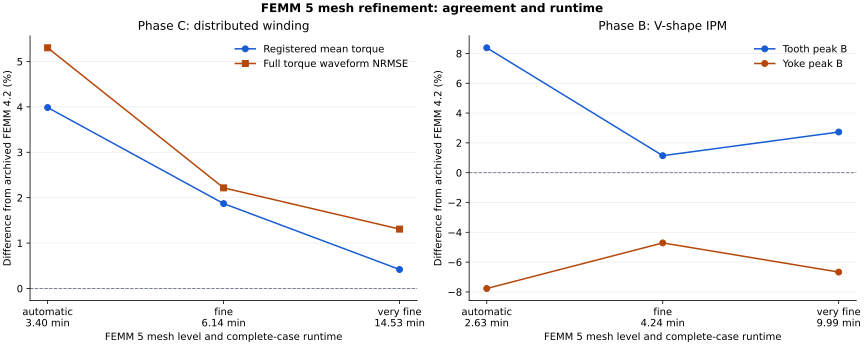

# FEMM 5 mesh-refinement checks (#112)

Explicit mesh refinement reduces the Phase C torque and IPM peak-flux
differences seen in the [initial FEMM 5 pilot](femm5-pilot.md). The first refined
level takes **6m08s for Phase C** and **4m14s for IPM**, while reducing Phase C
registered mean-torque difference from **3.99% to 1.87%** and the IPM tooth
peak-B difference from **8.38% to 1.14%**. The yoke difference improves from
**-7.77% to -4.71%**. A second refinement and cross-engine controls are below.

With equivalently refined 4.2 inputs, the finest IPM meshes agree in peak B
within **0.965% for teeth** and
**0.043% for yoke**. This exposes sensitivity in
the original 4.2 reference as well. The finest IPM mesh nevertheless changes
saved native parity to FAIL at the unchanged BEMF peak gate. Phase C retains
a pointwise torque gap against refined 4.2, so full convergence is not claimed.

[Machine-readable results, policies and hashes](femm5-mesh-convergence-summary.json) ·
[Scalable chart](femm5-mesh-convergence.svg) ·
[Validated FEMM 4.2 full-suite result](full-suite.md)

## Complete case sweeps

Differences below are relative to the frozen FEMM 4.2 reference. Mean torque
uses the registered benchmark grid; waveform NRMSE uses all 48 raw loaded
positions. Ripple differences are percentage points. Peak B uses the original
fixed sample locations at the first loaded position. Mesh counts are the
producer's reported count; meshes vary with rotor position.

Phase C: `spm_8p48s_distributed_femm_validation`.

| FEMM 5 mesh | Reported elements | Producer, s | Mean torque change | Raw torque NRMSE | Ripple change, pp |
| --- | ---: | ---: | ---: | ---: | ---: |
| automatic | 76,078 | 203.82 | +3.986% | 5.302% | +6.299 |
| fine | 135,830 | 368.48 | +1.870% | 2.216% | +1.589 |
| very_fine | 270,884 | 871.91 | +0.419% | 1.308% | -2.482 |

Refinement does not improve every metric monotonically. The Phase C yoke
peak-B difference is +0.454%
with automatic meshing, -3.040%
at fine, and -3.907%
at very_fine. All target and non-target metrics remain visible in the JSON.

Phase B: `ipm_vshape_8p12s_baseline_contract`.

| FEMM 5 mesh | Reported elements | Producer, s | Tooth peak-B change | Yoke peak-B change | BEMF fundamental change |
| --- | ---: | ---: | ---: | ---: | ---: |
| automatic | 50,592 | 157.89 | +8.382% | -7.771% | +0.868% |
| fine | 73,232 | 254.49 | +1.143% | -4.713% | +0.322% |
| very_fine | 129,490 | 599.44 | +2.730% | -6.670% | +0.011% |

The first refined IPM level also reduces mean-torque difference from +1.615%
to +0.903%, and raw torque waveform NRMSE from 1.487% to 0.946%.
Every new sweep retains all 48 loaded and 48 paired no-load analyses and all
registered extraction-audit frames. The unchanged public gate rules replay
against saved native results as **PASS for Phase C** at both refinements,
**YELLOW for fine IPM**, and **FAIL for very_fine IPM**. Physical values differ,
so these are not exact-equivalence results.
No new native collection or published reference replacement is performed.

The finest IPM mesh worsens both peak-B differences relative to fine; increasing
the element count does not monotonically improve these local samples. Its saved
native back-EMF peak difference is **15.742%**,
crossing the unchanged 15% FAIL boundary. The same replay metric was 14.779%
with the original frozen reference, 11.746% with automatic FEMM 5 and 13.938%
with fine FEMM 5. Fundamental back-EMF remains close, so this failure concerns
peak/waveform shape rather than its fundamental amplitude. The failure remains
visible; no tolerance or verdict is relaxed.

## Successive mesh changes

Between fine and very_fine, Phase C mean torque changes by
**-1.424%** relative to fine;
the full torque-curve NRMSE between those two FEMM 5 levels is
**1.964%**. Between the same levels,
IPM tooth peak B changes by
**+1.570%**
and yoke peak B by
**-2.054%**.
The JSON retains every scalar, raw-waveform difference and audit-frame count,
including steel RMS B, back-EMF, flux linkage and energy/coenergy diagnostics.

Three FEMM 5 levels test sensitivity and the observed refinement trend; they do
not establish an extrapolated continuum solution or eliminate local peak-B
sampling sensitivity. The original FEMM 4.2 reference is not a proven converged
oracle. Closer agreement with it is useful for compatibility, but does not by
itself prove higher accuracy.

## Paired refined-input controls

Each engine independently remeshes and solves the exact same copied refined
input at one rotor position. Phase C uses the retained last loaded position;
IPM uses the first position at which the registered peak-B metric is sampled.
FEMM 5 fresh probes reproduce the complete-sweep torque at that position within
1e-9 Nm and the IPM peak B within 1e-12 T. FEMM 4.2 is allowed to move with
refinement as well. The difference columns are FEMM 5 minus refined FEMM 4.2,
divided by the corresponding FEMM 4.2 magnitude.

| Input | Elements, 4.2 / 5 | Analysis, s, 4.2 / 5 | Point torque difference, Nm (%) | Tooth peak-B difference | Yoke peak-B difference |
| --- | ---: | ---: | ---: | ---: | ---: |
| c-fine | 179,686 / 134,848 | 27.299 / 1.986 | +0.252498 (+25.059%) | +0.852% | -1.103% |
| b-fine | 91,880 / 72,062 | 17.975 / 2.127 | -0.004840 (-0.479%) | -1.560% | +8.537% |
| c-very_fine | 297,550 / 269,878 | 64.228 / 6.471 | +0.142535 (+13.649%) | +0.148% | +0.115% |
| b-very_fine | 158,996 / 129,490 | 41.046 / 5.087 | -0.007249 (-0.721%) | +0.965% | +0.043% |

The full numeric outputs and hashes are retained. These controls distinguish
agreement with a refined 4.2 input from agreement with the old automatic mesh.
They remain single-position probes, with engine-dependent meshes, rather than
full 4.2 waveform-convergence or identical-mesh solver comparisons.

At Phase C's final loaded position, the cross-engine torque gap narrows from
**0.252498 Nm** at fine to
**0.142535 Nm** at very_fine, but the latter is still
**13.649%** of the refined 4.2 torque magnitude
at that low-torque position. That remaining gap prevents calling torque
converged based on the close mean against the old reference. For IPM, very_fine
brings the engines' yoke peak samples into much closer agreement while both
remain below the old 4.2 value; choosing only the mesh closest to the old value
would miss this movement in the reference itself.

## Runtime interpretation

The archived original FEMM 4.2 serial producer took
**2656.46s** for Phase C and
**1572.11s** for IPM. Against those observations,
the fine FEMM 5 case times give ratios of
**7.21x** and
**6.18x**, respectively. At very_fine,
the corresponding ratios are **3.05x**
and **2.62x**.

These full-case ratios combine solver/version, mesher, mesh policy and the
previously validated producer optimizations. The 4.2 full-case baselines are
archived serial observations, not fresh matched optimized controls. Fresh
cross-engine controls here are only the retained inputs above. Cases run
sequentially with one fixed core (mask 1), Windows 11, Ryzen 7 7700 and 64 GiB
RAM, with normal desktop activity. No simultaneous evaluation solves are used.
The read-only IPM first-frame observer performs a brief input capture.

This is two cases, not a new 29-case runtime. The earlier **1h52m02s** parallel
FEMM 4.2 collection remains the validated full-suite measurement; these ratios
must not be multiplied into it.

## Mesh policy and provenance

The original physical source remains public pin `738d9516e8500c5996c772bd96470472cbb9a0f9`
and adapter pin `8b95decda27d475ddbb75e99d92744ebc8e53b28`. The same official
FEMM 5 06Oct2026 portable runtime and owned TCP/Job Object lifecycle are used.
Requests, geometry definitions, material curves, magnetization, currents,
grids, loaded/no-load ordering, extraction methods and solver tolerances stay
fixed. Mesh-only controls are recorded separately in the actual runtime
identity; the original requested configuration is retained for comparison.

The fine and very_fine levels use the frozen adapter's existing explicit
regional size formulas and arc-segmentation presets. Actual values for both
studied cases are recorded in JSON, including per-region invocation counts.

| Mesh policy | Air (including IPM pockets) / steel / core / shaft, mm | Slots, mm | Airgap, mm | Magnets, mm | Arc maximum, deg |
| --- | ---: | ---: | ---: | ---: | ---: |
| automatic | automatic | automatic | automatic | automatic | 1.0 |
| fine | 1.5 | 1.0 | 0.45 | 0.9 | 0.5 |
| very_fine | 1.0 | 0.65 | 0.25 | 0.6 | 0.25 |

The IPM very_fine first input is captured after successful registered peak-B
sampling and before the next loaded save. The fine first-position control
uses that identical physical input with only arc/block mesh-size fields
replaced by the completed fine-run controls. Canonical physical bytes excluding
mesh fields are checked equal; its fresh FEMM 5 replay independently reproduces
the original fine first-position torque and peak B. Source and result hashes
are retained; an earlier observer attempt that produced no input is excluded.

## Use of the result

For Phase C, very_fine gives the closest registered mean-torque agreement among
the tested FEMM 5 levels; fine provides a faster compromise. For IPM, fine is
the better compatibility/runtime candidate among these tests: it improves both target peak-B
differences at lower runtime, while very_fine worsens them and crosses the
saved native BEMF peak gate. The finer IPM field samples agree better with
equivalently refined 4.2, so compatibility with the old reference must not be
mistaken for accuracy. A uniform finest-mesh policy or reference replacement
is not supported by these results. Review the successive changes, remaining
torque gap and native peak failure before choosing a reference policy.

Both policies remain provisional. Frozen reference data, public requests,
acceptance gates and scientific qualification are unchanged. A full-suite
FEMM 5 collection, its case-concurrency policy, repeated idle-host timing
controls and full FEMM 4.2 waveform convergence remain unmeasured here.
