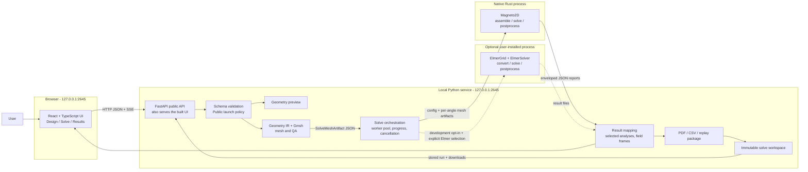

# coilEM architecture

This document describes the public, local-only coilEM application at a high
level. It covers the paths from both motor and non-motor Halbach definitions
in the browser to electromagnetic reports.
The diagram below describes motor solves and their durable run storage;
Halbach reports follow the separate session-based path described below.

For solver command lines and physics boundaries, see
[Magneto2D](MAGNETO2D.md) and [Elmer FEM](ELMER.md). The solve-ready non-motor JSON interface is
documented separately in
[Generic magnetostatic field solver](GENERIC_MAGNETOSTATIC.md). To run the
application and complete an example analysis, see
[Getting started](GETTING_STARTED.md).

## System overview



An installed coilEM is one process: the `coilem` launcher serves the built UI
and the API together on `127.0.0.1:2645`, falling back within 2645 to 2654
when that port is taken. A source checkout runs them apart, the Vite dev server
on port 5173 and the API on port 8000. Either way the browser talks only to
loopback.

The frontend does not run finite-element code. The Python service owns input
validation, geometry, meshing, process control, and durable storage.
Magneto2D owns its magnetostatic finite-element assembly, nonlinear solve, and
electromagnetic postprocessing. With `COILEM_ENABLE_ELMER=1` and explicit selection, the optional Elmer
adapter produces Elmer cases, launches separately installed executables, and
maps their result files into the same public result contract. Elmer is disabled,
hidden, and not probed by default; it is a development lane outside the release claim.

## Component responsibilities

| Component | Responsibility |
| --- | --- |
| Public frontend | Edits a motor definition, draws it in 2D and 3D, displays mesh QA, streams solve progress, plots results and field playback, compares saved runs, and downloads stored reports. |
| `coilem` launcher | Starts the service, serves the built UI from the same process, opens the browser, and runs `coilem benchmark`. |
| Public FastAPI service | Exposes the loopback API, validates requests, enforces the launch boundary, coordinates work, and sanitizes responses. |
| Geometry and Gmsh layer | Converts the motor definition into solver geometry, generates triangular meshes, tags physical regions, and rejects meshes that fail QA. |
| Python solver orchestration | Selects the rotor-angle plan, routes the explicit solver choice, produces mesh artifacts, runs rotor positions on a pool of worker processes, handles progress/cancellation, and maps raw reports into the application result. |
| Analyses and performance | Turns solver reports into the selected outputs: cogging torque, loaded d/q flux linkage, winding resistance, copper and iron loss, magnet-temperature derating, and the flux-linkage map behind the torque–speed and efficiency maps. |
| Qualification status | Rates each combination of rotor, winding and excitation as qualified or experimental from the registered benchmark report. Design Health, Results, the PDF and the CSV all read that one rating. |
| Reference models | Pinned published motor geometry (the Pyleecan Prius, an LRK outrunner) that the pipeline loads through one hook instead of testing for a reference by name. |
| Magneto2D | Assembles and solves the 2D magnetostatic FEM system, iterates nonlinear steel, and computes torque, flux linkage, Back-EMF, and field outputs. |
| Optional Elmer adapter | With the development opt-in, detects qualified user-installed executables, remeshes each rotor position, converts Gmsh meshes with ElmerGrid, runs ElmerSolver, and maps results without bundling or linking Elmer. |
| Solve workspace | Publishes a completed run atomically with inputs, provenance, immutable results, retained artifacts, PDF, CSV, and replay package. Keeps one compact field frame per rotor position; playback images are drawn from them on demand into a disposable cache. |

## A Halbach solve from end to end

Cylindrical and linear Halbach workspaces validate `halbach_array_config` v1 or
`linear_halbach_array_config` v1, create a non-motor planar artifact, and lower
it through a feature-tag-driven Gmsh adapter. The
adapter assigns every triangle one material and remanence source, then emits
the unchanged generic `magnetostatic_problem` v1 contract.

Magneto2D field mode solves that document without learning Halbach geometry or
report policy. Python samples the bore/leakage regions or linear probe lines,
calculates Halbach-specific metrics, and embeds the complete generic field
report and replayable problem/hash in the returned report. The browser retains
that result for the session; these solves do not publish motor-run manifests
or enter saved-run comparison. Cylindrical exports are generated from the
submitted report. See [Halbach arrays](HALBACH_ARRAY.md).

## A motor solve from end to end

### 1. Design and preview

The browser starts with a versioned motor configuration containing:

- topology, rotor layout (inner or outer rotor), stator, rotor, and winding
  geometry;
- material identifiers, and optionally a wire for phase resistance;
- the operating point, with sinusoidal or ideal six-step excitation, and
  mesh/solver settings; and
- the selected analyses.

`POST /preview` validates that configuration and returns display geometry,
the winding layout and the design's qualification status. This path does not
run the finite-element solver. The 3D view is drawn in the browser from the
same configuration.

### 2. Mesh preparation

`POST /solver/mesh-preview` applies the public policy, validates the geometry,
builds Geometry IR, and asks Gmsh for a triangular mesh. Mesh QA checks such as
region coverage and minimum element quality run before a solve is allowed.

The backend converts the Gmsh result into a `SolveMeshArtifact`. That contract
contains the mesh, physical-region identity, boundary information, material
assignment provenance, magnetization, and winding current-density data needed
by Magneto2D. The frontend receives visualization data and an opaque
`solve_mesh_key`; raw cache paths are not an API contract.

### 3. Validation and solve

`POST /solve/validate` returns actionable validation errors, warnings, and
local estimates without starting a solve.

The application normally uses `POST /solve/stream`. The response is a
server-sent event stream with progress, followed by either a completed result
or a typed error. `POST /solve/cancel` stops the active local solve.

For rotor motion, the public motor path uses native Gmsh meshes and Magneto2D.
Each rotor position gets its own mesh, reused across positions where symmetry
allows, and positions are solved in parallel on worker processes. One request
can carry several analyses: the loaded sweep, a no-load sweep for Back-EMF, a
no-current cogging sweep, and an optional flux-linkage map over current and
current angle. The map runs through `/performance/map/stream` and can be
resumed.
The optional Elmer development lane uses a fixed profile with remesh-per-position
motion, Arkkio torque, and direct UMFPACK. Solver selection is explicit;
disabled or unavailable Elmer requests are rejected before a solve starts.

### 4. Result mapping and report

The backend maps raw solver reports into the public result model. The report UI
can show:

- average torque and torque ripple;
- phase and line Back-EMF, their fundamentals and harmonic spectra;
- torque and Back-EMF waveforms;
- cogging torque and its harmonics;
- loaded d/q flux linkage, apparent Ld and Lq;
- phase resistance, copper and iron loss, and efficiency;
- torque–speed, power–speed and efficiency maps;
- peak tooth and yoke flux density;
- torque and Back-EMF constants;
- solver convergence, mesh, material, and operating-point provenance;
- each output's qualification status; and
- solved magnetic field views and playback when requested.

Before the completed result is returned, coilEM writes the run to a partial
directory, generates its PDF, CSV, and replay package, hashes the evidence,
and atomically publishes the run. A completed run is immutable; reopening or
rerunning it restores inputs and starts a new analysis rather than modifying
the old evidence.

Field frames are stored compactly, one per rotor position. Playback images
are not part of the run: they are drawn from the frames in the background into
a disposable cache, and the browser asks for them through
`/solve/playback-frame` and `/solve/playback-status`. The stator-only field
shown beside the solved field comes from `/solve/field-composition/armature`.

See [Local solve workspace](local_solve_workspace.md) for the directory layout,
retention policy, integrity checks, and replay behavior.

## Public API surface

The API is grouped into seven surfaces:

| Surface | Representative paths |
| --- | --- |
| Runtime facts | `GET /health`, `GET /materials`, `GET /openapi.json` |
| Design and mesh | Motor `/preview` and `/solver/mesh-preview`; cylindrical `/halbach/preview` and `/halbach/mesh-preview`; linear `/halbach/linear/preview` and `/halbach/linear/mesh-preview` |
| Solve | `POST /solve/validate`, `POST /solve/stream`, `POST /solve`, `POST /solve/cancel`, field frames and playback under `/solve/field-frame`, `/solve/playback-frame` and `/solve/playback-status`, and the stator-only field under `/solve/field-composition/armature` |
| Performance | `POST /performance/map/stream` and `/performance/map/status` for the flux-linkage map, `POST /performance/drive` for the torque–speed envelope, and `POST /performance/report/{kind}` for its PDF and CSV |
| Stored runs | `GET /runs`, run loading, run comparison, PDF/CSV/package downloads, folder reveal, and explicit deletion |
| Tutorials | Local, solver-backed `/tutorials/*` lesson routes |
| Halbach application | Cylindrical `/halbach/solve/validate`, `/halbach/solve/stream`, and `/halbach/export/{export_kind}`; linear `/halbach/linear/solve/validate` and `/halbach/linear/solve/stream` |

The exact launch allowlist is documented in
[Public runtime boundary](PUBLIC_BOUNDARY.md).

## Important contracts

### Motor configuration

The Python model is the authoritative public request schema. It validates
dimensions, topology-specific fields, rotor layout, winding data, materials,
solve settings, and the selected analyses before meshing. Design files are the
same JSON, saved as `.coilem`; older `.openem` files still open.

### Solve mesh artifact

The JSON artifact between Python/Gmsh and Rust keeps mesher-specific geometry
out of the numerical solver. It includes triangular connectivity in
millimeters at the JSON boundary; Magneto2D converts coordinates to SI units
before assembly.

### Magneto2D report envelope

Motor mode emits a `solve_report`, `sweep_report`, or `batch_solve_reports`
envelope; generic field mode emits `field_solution_report`. The envelope
records schema kind and provenance in addition to the numerical payload.

### Durable run manifest

The run manifest binds the project, resolved request, material record, solver
version, application commit, result, retained artifacts, and exports with
hashes. Downloads are served from this stored run and do not start a solver.

## Runtime and trust boundary

- The public service binds to `127.0.0.1`, not to a LAN or public interface.
- The public frontend accepts only loopback API addresses.
- Browser origins are limited to the documented local development and preview
  ports, or, for the `coilem` launcher, its own bound `127.0.0.1` origin.
- The launcher serves only an exact list of UI paths, kept apart from the API
  allowlist.
- The launch configuration policy accepts Magneto2D with native Gmsh meshes.
  Elmer discovery and selection require `COILEM_ENABLE_ELMER=1` and a qualified
  user-installed runtime; this development opt-in does not expand the release claim.
- Cloud services, identity, billing, telemetry, FEMM, internal diagnostics,
  and thermal requests are outside the public launch runtime. Winding and
  magnet temperatures are inputs, not solved. FEMM is used only to produce the
  frozen benchmark references, never at run time.
- The launch material set and its interpretation limits are documented in
  [Materials](../MATERIALS.md).

## Repository map

```text
frontend/src/public/          Public React application and API client
frontend/src/components/      Shared landing preview, workflow hero, and tutorials
backend/launcher.py           The `coilem` command: serves UI and API, opens the browser
backend/public_ui.py          Built-UI serving for the launcher, with its own path allowlist
backend/public_main.py        Loopback FastAPI entry point and route allowlist
backend/public_routes/        Preview, solve, performance, stored-run, and tutorial routes
backend/public_routes/halbach.py  Cylindrical and linear Halbach API routes
backend/public_policy.py      Fail-closed launch configuration policy
backend/qualification.py      Qualified or experimental status of a design and its outputs
backend/reference_models/     Pinned published motor geometry (Pyleecan Prius, LRK)
backend/rotor_layout.py       Inner-rotor and outer-rotor facts shared by the pipeline
backend/gmsh_solver.py        Native Gmsh mesh production and mesh QA
backend/sweep_planning.py     Rotor-angle plans for loaded, no-load and cogging sweeps
backend/halbach/              Non-motor geometry, mesh lowering, solve adapter, metrics, and exports
backend/elmer/                Optional external Elmer discovery, case generation, execution, and result mapping
backend/solver/               Python solve orchestration, worker pool, and result mapping
backend/selected_analyses.py  Runs the selected analyses and the resumable drive map
backend/flux_linkage_map.py   Flux-linkage map over current and current angle
backend/drive_performance.py  Torque–speed envelope and efficiency map from that map
backend/cogging.py, dq_flux_linkage.py, iron_loss.py, loss_breakdown.py,
backend/winding_resistance.py, magnet_temperature.py   Per-output calculations
backend/magneto2d_adapter/    Rust process and JSON artifact adapter
backend/field_frame_codec.py  Compact storage for solved field frames
backend/run_field_playback.py Playback images drawn on demand from a run's field frames
backend/solve_workspace.py    Durable run storage and integrity checks
backend/benchmark_suite/      The A/B/C/D benchmark harness behind `coilem benchmark`
solvers/magneto2d/            Rust FEM solver and postprocessor
benchmarks/                   Frozen FEMM references and published qualification records
tools/                        Benchmark, qualification, release and snapshot tooling
```
