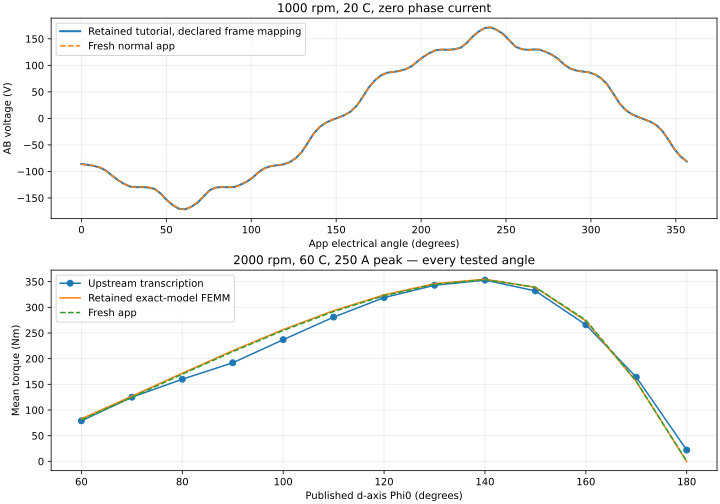
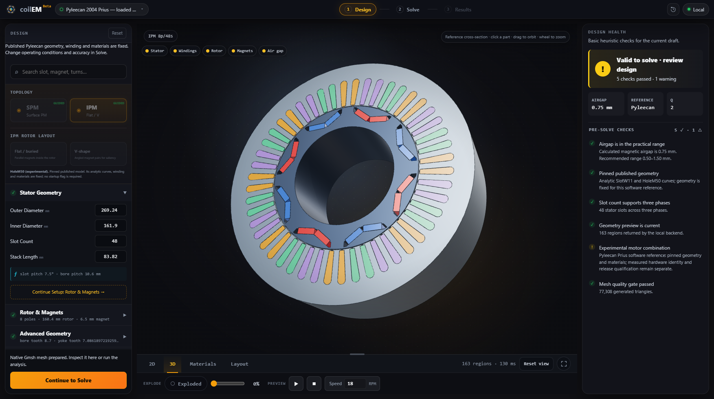
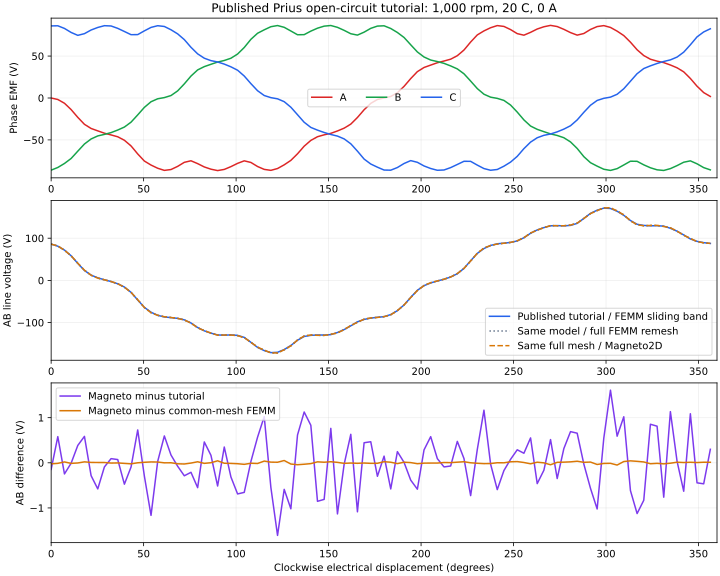

# Pyleecan 2004 Prius software benchmark — v1

This is the exact, pinned Pyleecan software model selected for issue #126 and
the v0.4.0 release plan. It is distinct from the ORNL hardware correlation in
[#69](https://github.com/coilemdev/coilem/issues/69) and
[#82](https://github.com/coilemdev/coilem/issues/82). Agreement here does not
establish measured Prius hardware accuracy. The original Yang 2013 paper's
full text was not obtained, so paper-to-model identity remains unverified.

The application remains 0.3.1 and Magneto2D remains 0.3.3. These are development
candidate measurements. The final v0.4.0 candidate must rerun the selected
benchmark after its code and numerical settings are frozen.

## Fresh public-app results

The complete Windows run measured clean commit
`d993d7674354cc723ad107e7a5452477c5f660ea`: **17 jobs, 568 actual field reports,
10/10 software checks passing**. [Full results and all thirteen torque points](app-results.md),
[waveforms, source identities and artifact hashes](app-results.json), and the
[original complete registration](app-registration.json) retain the measured conditions.

| Measurement | Fresh app | Retained reference | Difference |
| --- | ---: | ---: | ---: |
| Tutorial AB sampled RMS, 1000 rpm / 20°C / 0 A | 107.513838 V | 107.558193 V | −0.0412% |
| Tutorial AB sampled peak | 171.833919 V | 171.330191 V | +0.2940% |
| Tutorial AB waveform relative L2 | 0.3983% | Fixed frame mapping, no fit | — |
| Loaded mean, 2000 rpm / 60°C / 250 A peak / Φ₀=140° | 353.950530 Nm | 354.953115 Nm, FEMM 16-pose half-cycle control | −0.2825% |
| Maximum mean difference across all thirteen current angles | 2.228438 Nm | FEMM, same physical model | 0.6282% of FEMM peak |
| Entire curve RMS difference from upstream transcription | 11.445109 Nm | All thirteen upstream values retained | No hardware verdict |



The independent 64-position control gives **353.951971 Nm** (+0.001441 Nm
from Normal/32). Fine/32 gives **353.933789 Nm** (−0.016741 Nm), with **82,872**
first-pose triangles versus Normal's **77,308**, a 7.2% increase. These controls
bound the observed loaded-mean sensitivity; they do not establish systematic
spatial convergence or refine every requested output. The maximum final
residual is **9.9658e-10**, current-source error **2.2737e-13 A**, and absolute
source/linkage duality error **5.6843e-14 J** across all 568 retained reports.

The collection ran from **00:30:25 to 01:25:14 UTC on October 19, 2026**
(October 18 locally): **54m49.3s**, including artifact compression. Per-job solve
wall times total **40m18.7s** and exclude the later gzip archives. Frontend
build/browser checks also ran on the host during this collection, so these
are informational timings. Python was 3.12.14, Gmsh 4.15.2, NumPy 2.4.6 and
Pydantic 2.13.4. The native binary SHA-256 was
`5bc90b1c45b56eb12d472ff21082b8182ef909c8316294e873ddd71b0399de8d`.

Raw meshes, native inputs/reports and portable solver results remain retained
locally; the JSON records their original hashes. The original registration is
published byte-for-byte. This is development evidence for #126; the final
v0.4.0 candidate rerun remains outstanding.

## Load the two cases

In the normal workspace, use **Design file menu → Examples → Benchmarks**:

| Case ID (version is part of the ID) | Example | Mechanical speed | Magnets | Phase current | Published angle |
| --- | --- | ---: | ---: | ---: | ---: |
| `prius-2004-tutorial-bemf-v1` | Pyleecan Prius · tutorial BEMF | 1000 rpm | 20°C | 0 A | Φ₀ = 140°, immaterial at zero current |
| `prius-2004-loaded-torque-v1` | Pyleecan Prius · loaded torque | 2000 rpm | 60°C | 250 A peak = 176.776695 A RMS | Φ₀ = 140° from the d-axis |

The [tutorial file](../../../frontend/src/public/examples/prius-2004-tutorial-bemf-v1.coilem)
and [loaded file](../../../frontend/src/public/examples/prius-2004-loaded-torque-v1.coilem)
also open through the ordinary file picker. Use **Continue to Solve**, retain
the saved Custom plan for reproduction, then **Run analysis**. No optional
reference runtime or experimental rotor startup flag is needed for these fixed
models. The general editable HoleM50 rotor still requires its existing opt-in.

Geometry, winding and materials are fixed. Solve allows current, current angle,
speed and accuracy experiments; their actual requests are saved. Changing an
operating point does not create a new reference target. Loading and reopening
retain the geometry reference, case ID, temperature and embedded material curve;
the backend rejects an altered fixed model instead of substituting a generic
slot, winding or steel. Case revisions that alter the protocol need a new ID.

## Workspace validation

The [workflow validation record](workflow-validation.json) pins the clean UI
revision, tested source hashes and successful production-build/browser checks.
Both fixed cases load, preview and enter Solve with their actual temperatures;
the design-file contract checks preserve the complete model on save/reopen.
The browser check validates routes and geometry. Field results are collected
separately through the public solve pipeline described below.



This preview extrudes the 2D reference through its physical stack length. It is
not a 3D field calculation.

## Model and source identity

The machine is [Toyota_Prius.json at cbfe7be3](https://github.com/Eomys/pyleecan/blob/cbfe7be3b8a50dbcdecccb655cc7ea74f2443890/pyleecan/Data/Machine/Toyota_Prius.json),
SHA-256 `a8922c4f712c38696e6dcf7e800ad5615a0b22dd45a802574f749a59945c8036`.
The same machine bytes occur in Pyleecan 1.5.0, commit
`e04992f98f76047da9ae1ba9b8db065aa487cc9e`. The export preserves analytic
lines and arcs, the rounded SlotW11 mouths/bottoms, all HoleM50 pockets, winding
signs and magnet directions. The analytic asset SHA-256 is
`3fd70d01f18a814661c055706ee18314a32670a413cec8a686665230b21c4f7e`.

| Physical input | Fixed value |
| --- | --- |
| Stator OD / bore | 269.24 / 161.9 mm |
| Rotor OD / bore | 160.4 / 110.64 mm |
| Air gap / steel stack | 0.75 / 83.82 mm |
| Poles / slots / magnets | 8 / 48 / 16 |
| Slot mouth / bottom radius | 1.93 / 4 mm |
| Each magnet | 18.9 × 6.5 mm |
| Winding | Exact published phase/sign matrix, one distributed layer, coil span 6 slots, 9 turns per coil, 72 series turns per phase, one parallel path |
| Steel | Exact embedded 44-point M400-50A B-H curve in both roles |
| B-H curve SHA-256 | `a057ad7be7d38bd148b7ea67b8dbf64d0874c9226efb8c9cbea6dcd284566899` |
| Magnet | Br(20°C) = 1.24 T, recoil μr = 1.05, αBr = −0.001/K |
| Magnet at 60°C | Br = 1.1904 T, factor 0.96 |
| Boundary conditions | Outer Az = 0; excluded bore is a natural boundary |

The published generator uses steel fill factor 1; the JSON's Kf = 0.95 is not
introduced as an extra correction. No magnet-strength or current-angle fit is
applied. The model tiles the annulus with 91 physical IR regions: one stator,
one air gap, one rotor core, 48 winding slots, 24 pocket-air regions and 16
magnets. Preview payloads also contain display overlays, which are not extra
physical regions. Both 2D and extruded 3D previews retain the independent bore
and cavity contours. There is no fabricated shaft or axial leakage model.

The reference data is Apache-2.0, copyright EOMYS ENGINEERING and the Pyleecan
developers. [THIRD_PARTY_NOTICES.md](../../../THIRD_PARTY_NOTICES.md#pyleecan-prius-reference-data)
records attribution, the representation changes and the full license.

Adapted from Pyleecan reference data. No affiliation with or endorsement by
EOMYS, the Pyleecan project, or Toyota. Both bundled `.coilem` examples and
designs saved from either reference case carry the source, copyright,
conversion notice, affiliation statement and complete Apache-2.0 license in
`reference_notice`. Older reference files gain this notice when saved again;
operating-point experiments retain it.

## Frozen numerical and output conventions

The app uses full native Gmsh geometry, precise node placement, normal mesh
density, no corner/sidewall refinement, and an actual mesh for each rotor pose.
The generic slot-pitch rotation/solution shortcut is disabled for this model.
An already generated mesh at the same pose may be cached across operating
points; its signed currents are rebaked using its actual slot areas.
The geometry asset hash participates in mesh identity. Each slot's signed nine
ampere-turns per phase ampere is divided by its actual meshed area; this is
checked independently by integrating the element sources.

The preset requests nonlinear Newton, direct linear solving, a 200-iteration
ceiling, nonlinear tolerance 1e-8 and Newton tolerance 1e-9. Native reports retain
the actual solver method, residual history and effective process environment;
a requested method is not evidence that every internal solve used that method.
Torque is the native air-gap weighted-stress integral, scaled once by the
83.82 mm physical depth and reported clockwise-positive. No additional stack
or calibration multiplier is applied. The report integrates linkage from each actual winding region and its signed
published turns, using nodal Az. The source/linkage duality check enforces
`sum(lambda_phase*I_phase) = stack_length*integral(Az*Jz*dA)`. Generic angular
slot bins are not used for this reference's linkage or slot-current display.
The request sets one native worker;
normal orchestration may run separate meshes and field processes concurrently.

The source drawing is rigidly aligned by −3.75° and starts at
52.49991619047166 mechanical degrees. Reflection into the app's clockwise frame
uses the axial-vector transformation M′ = −R M, with Jz unchanged. Increasing
public electrical angle moves the physical rotor clockwise. Actual phase
currents are `I_peak*cos(theta_clockwise + Phi0 + [0,-120,120] degrees)`.
Saved reports identify this d-axis convention; the generic CLI's unused
q-axis input description is retained separately for audit. Zero-current
back-EMF artifacts zero both the element sources and phase-current provenance.

The tutorial preset has 100 actual positions over a half-open 360° electrical
cycle, step 3.6° electrical / 0.9° mechanical. The app performs its normal
zero-current torque lane and a separate no-load voltage lane. These are actual
fields, not reconstructed samples. The loaded preset has 32 actual positions,
11.25° electrical / 2.8125° mechanical, plus its separate 32-position no-load
voltage lane. The current-angle study uses 16 actual full-cycle positions per
angle. Angular refinement uses 64 positions; mesh refinement uses Fine at the
original 32 positions, changing one control at a time.

Voltage means open-circuit back EMF, not terminal voltage under load. The saved app
waveform uses the positive periodic central derivative of phase linkage, the
same derivative polarity as Pyleecan's `comp_emf`. The drawing reflection
reverses source-frame angular direction: at app electrical index `i`, compare
linkage with reference index `(-i) mod 100`, and voltage with the negative
reference voltage at that index. This mapping follows the coordinate transform;
no phase, polarity or magnitude is fitted.
AB line voltage is A minus B. Sampled line RMS, sampled line peak and fundamental
phase-to-neutral RMS are reported separately; a √3 conversion is not used to
substitute for an actual sampled line waveform.

## Retained tutorial and matched-mesh evidence

The original optional-runtime study runs the open-circuit branch of
[Tutorial 03 at Pyleecan 1.5.0](https://github.com/Eomys/pyleecan/blob/e04992f98f76047da9ae1ba9b8db065aa487cc9e/Tutorials/03_tuto_Plots.ipynb).
Notebook SHA-256 is
`d4943674908c728ac881f64f25af8d3f516ff95300b4d85335c6af8af5f6352b`.
It has 50 actual fields over 180° electrical, temporal anti-periodicity to
reconstruct 100 electrical-cycle samples, and four copies for 400 mechanical-
revolution samples. The tutorial uses sliding-band FEMM and spatial symmetry.
The full-model control uses the same 50 physical poses without those shortcuts.
The notebook itself plots flux; it provides no official numerical BEMF target
or measured BEMF waveform.

| Historical calculation, 1000 rpm / 20°C / zero current | Sampled AB RMS | Sampled AB absolute peak |
| --- | ---: | ---: |
| Pyleecan tutorial / sliding-band FEMM | 107.558193 V | 171.330191 V |
| Full-model FEMM remesh | 107.668699 V | 172.173361 V |
| Magneto2D on those same full FEMM meshes | 107.669363 V | 172.161387 V |

The matched-mesh native line RMS differs by +0.10336% from the tutorial and
+0.000617% from FEMM. Waveform relative L2 errors are 0.57765% and 0.01842%,
respectively. The maximum native final residual is 9.7313e-10. Independent
nodal-A extraction agrees with FEMM circuit linkage within 5.4073e-16 relative.
Two tutorial repeats have identical flux and voltage samples.



[pyleecan-tutorial-results.json](pyleecan-tutorial-results.json) retains all
waveforms, settings, eight checks, runtime identities and 50 per-pose artifact
identities. Its checks are numerical software parity limits, not hardware
acceptance. This historical evidence is retained unchanged and is not relabeled
as a new public-candidate measurement.

## Entire retained loaded torque curve

The source vector comes from the [pinned Pyleecan validation test](https://github.com/Eomys/pyleecan/blob/e474b1e7944a4a90f2c3588025db27f752d9944e/Tests/Validation/Electrical/test_EEC_PMSM.py).
It attributes the values to Yang, Krishnamurthy and Brown, IEMDC 2013,
DOI 10.1109/IEMDC.2013.6556267. This is a transcription in a software test,
not an independently verified hardware dataset. A separate upstream assertion
uses **82 Nm ±10% at 60°**; the vector's first point is **79 Nm**. These are
different references and are not silently combined.

All historical rows below use 250 A peak, 2000 rpm and 60°C magnets. Each
solver/model lane has eight actual fields per current angle over the 180°
electrical anti-period: 104 actual solves per lane. Arithmetic means use actual
torque samples; no interpolated torques enter the mean.

| Φ₀ | Upstream vector | FEMM, exact Pyleecan | Native, same FEMM mesh | Native minus upstream |
| ---: | ---: | ---: | ---: | ---: |
| 60° | 79 | 82.985 | 82.912 | +3.912 |
| 70° | 125 | 126.896 | 126.770 | +1.770 |
| 80° | 160 | 171.695 | 171.519 | +11.519 |
| 90° | 192 | 215.527 | 215.307 | +23.307 |
| 100° | 237 | 256.697 | 256.446 | +19.446 |
| 110° | 281 | 293.533 | 293.269 | +12.269 |
| 120° | 319 | 324.210 | 323.936 | +4.936 |
| 130° | 343 | 346.079 | 345.794 | +2.794 |
| 140° | 353 | 354.727 | 354.459 | +1.459 |
| 150° | 332 | 338.843 | 338.664 | +6.664 |
| 160° | 266 | 273.425 | 273.329 | +7.329 |
| 170° | 164 | 155.525 | 155.465 | −8.535 |
| 180° | 22 | −0.329 | −0.362 | −22.362 |

All torques are Nm. The maximum same-model FEMM/native mean difference is
0.285 Nm, 0.0804% of peak FEMM torque. Native full-curve RMS error against the
upstream vector is 12.18 Nm, 3.45% of the 353 Nm peak. **The 90° and 180°
discrepancies remain visible; peak agreement does not validate the entire curve.**
Sixteen-pose half-cycle controls at 60°/140° give FEMM 82.957/354.953 Nm and
native 82.953/354.882 Nm. The largest 8→16 mean change is 0.424 Nm.

[pyleecan-loaded-results.json](pyleecan-loaded-results.json) preserves the entire
curve, all torque waveforms, hashes, runtimes, residuals and refinement controls.
It also retains an older ORNL-derived corrected-model lane for historical
context; that lane is not the Pyleecan example shipped by this change.
[pyleecan-ui-results.json](pyleecan-ui-results.json) preserves the preceding
experimental-branch app/browser measurement: 353.950530 Nm at 32 poses, and
an earlier 204.078814 V sampled line RMS at 2000 rpm / 60°C. That earlier app
BEMF used generic angular winding bins after reflection; its phase extraction
is superseded by the explicit published-region extraction in this change.
The loaded stress-torque measurement is unaffected. Its source commit and dirty
state are explicit; it is a comparison reference, not a new qualification.

The [versioned protocol](protocol.json) records the sampling, fixed waveform
mapping and software-parity limits selected using the retained studies before
the complete fresh run. It does not define hardware acceptance.

## Remaining hardware discrepancy and model differences

The [registered ORNL table](../../hardware-validation/ornl-prius-2004/target-back-emf.json)
records **85.7 V line RMS / 150 V peak at 1000 motor-shaft rpm**, with nominal
25°C oil. The software tutorial uses **20°C magnets**; the loaded reference uses
**60°C magnets**. Oil temperature does not establish the magnet temperature,
which ORNL did not record. The fresh report retains the direct one-speed
voltage difference as context, with no hardware pass/fail or fitted correction.

The separate [ORNL reconstruction report](../../hardware-validation/ornl-prius-2004/report-v1.md)
retains its own frozen geometry and winding assumptions, M350-50A steel,
Br = 1.235 T at an uncertain magnet test temperature, and a mean RMS excess of
26.6% across twelve speeds. Its pocket dimensions were inferred from ORNL
figures. This pinned Pyleecan model instead retains its analytic SlotW11/HoleM50
curves, the published M400-50A curve and Br(20°C) = 1.24 T with the stated
temperature coefficient. These models are not interchangeable. The earlier
hardware residuals remain unresolved; close FEMM agreement for this software
model cannot remove them. See the [hardware source audit](../../hardware-validation/ornl-prius-2004/source-audit.md)
for measured versus inferred inputs. Axial leakage, skew and magnet condition
have not been established as explanations by this 2D benchmark.

## Reproduce the public app benchmark

Use the documented coilEM Python environment and build the current native
binary. Start from a clean commit and keep generated output outside the source checkout:

```powershell
cargo build --release --locked --manifest-path solvers/magneto2d/Cargo.toml
python -m tools.benchmark_prius --out ../benchmark-output/prius-v1 --curve --refinement
python -m tools.report_prius_benchmark ../benchmark-output/prius-v1 --out ../benchmark-output/prius-v1-report
```

The runner uses the ordinary public parser and `Magneto2DSolver` with the public
clockwise surface. It records the exact case requests, every physics-source
hash, native binary hash, environment, actual output waveforms, and residual
histories in the retained native reports. Raw local input/mesh/report artifacts
are also retained as gzip with original-byte hashes. Portable results remove
machine paths. New collections use registration **v2**. The common A/B/C/D
identity and output-lock contracts guard the source, commit, runtime and solver
binary before and after each job. A changed identity prevents that job from
being accepted as complete.

Before any fields run, the collector copies the protocol, tutorial/loaded/UI
reference results and ORNL context table into `frozen-inputs/`, retaining their
exact hashes. Analysis uses those copies and rejects changed frozen files;
editing the current checkout's grading files cannot change a registered run's
verdicts. Each job retains its actual request, environment, result hashes and
before/after identities.

The report command audits a complete collection and emits JSON and Markdown;
add `--plot` in an optional Matplotlib environment for the standalone SVG.
The published report keeps its Markdown, JSON, SVG and protocol README together.

For one job, use `--only loaded-torque-32`; curve jobs also need `--curve`, and
refinement jobs need `--refinement`. Use a fresh output directory for each new run.
`--only` records the selected job's full actual request rather than pretending
to execute the entire suite. Current and mesh/angular experiments retain the
case's source identity alongside their modified conditions.

Resume a failed or interrupted **v2** collection with its saved selection:

```powershell
python -m tools.benchmark_prius --out ../benchmark-output/prius-v1 --resume
```

Resume verifies the original source/runtime/binary identity, frozen grading
inputs and every completed request, result and retained artifact hash before
skipping completed work. Failed/interrupted attempts remain in separate
directories; a new attempt gets its own directory. Resume rejects a changed
selection or changed artifacts. A completed, verified run executes no fields.

The published development collection above remains its original **v1** evidence,
including its original collector and analyzer hashes. Its numerical sources,
registration, measurements and checks have not been restamped by these tooling
fixes. V1 did not retain frozen grading copies or per-job identity checks, so
it cannot be resumed as v2. Reanalyzing a local v1 collection requires the
explicit `--legacy-unpinned` report option; the new output is labelled
**post-hoc reanalysis** using the grading inputs selected at analysis time.
That output is separate from the original published report.

The tutorial and matched-mesh reference controls can be reproduced separately
with the optional Pyleecan 1.5.0 / SciDataTool 2.5.0 / FEMM 4.2 environment.
Fetch the unchanged machine and notebook from the pinned links above. These
tools verify source hashes; no reference solver is needed by the normal app:

```powershell
python -m tools.pyleecan_prius_tutorial --machine Toyota_Prius.json --notebook 03_tuto_Plots.ipynb --out tutorial-reference
python -m tools.pyleecan_prius_reference --machine Toyota_Prius.json --points 50 --speed-rpm 1000 --electrical-range-deg 180 --initial-rotor-deg 52.49991619047166 --clockwise --out tutorial-full-femm
python -m tools.pyleecan_prius_mesh_compare --femm tutorial-full-femm --out tutorial-magneto --native-input docs/benchmarks/pyleecan-prius-v1/pyleecan-reference-input.json
python -m tools.compare_pyleecan_tutorial --reference tutorial-reference --femm tutorial-full-femm --native tutorial-magneto --femm-executable C:/femm42/bin/femm.exe --out tutorial-results.json
```

The historical loaded result retains the source registration, settings and
per-pose hashes needed for its optional reference reproduction. The loaded
producer and comparison commands document their required inputs through
`python -m tools.pyleecan_prius_loaded_reference --help` and
`python -m tools.compare_pyleecan_loaded --help` in that optional runtime.

## Development package acceptance

The [installed Windows wheel check](installed-wheel-validation.json) records a
local build at `3e640ac` with an explicitly stamped public commit, both
reference JSON assets byte-identical to source, both 91-region previews and
a successful **12-position** zero-current native solve with back-EMF disabled.
All **53** installed physics sources match the Windows record. The wheel keeps
its own binary hash; the full field collections retain their original hashes.
The complete local Python suite passed **1113 tests / 3 skipped**, Rust passed
**261**, and lint, snapshot/publication and frontend build checks passed.

This reduced package check keeps the actual modified request. It does not
replace the full 100-position tutorial, loaded curve/controls or final release
walkthrough. The package version remains 0.3.1 and this artifact was not uploaded.

## Release acceptance still required

The current cases remain experimental software references. Before tagging
v0.4.0, freeze the final candidate, rerun both normal app cases, retain the full
13-angle result and controls, rerun the registered A/B/C/D suite, and record
the app/browser and installed-package checks. Mesh/angular controls bound
observed discretization sensitivity; they do not prove global spatial
convergence. Original-paper identity, ORNL hardware correlation and any 3D
leakage explanation remain separate open work.
