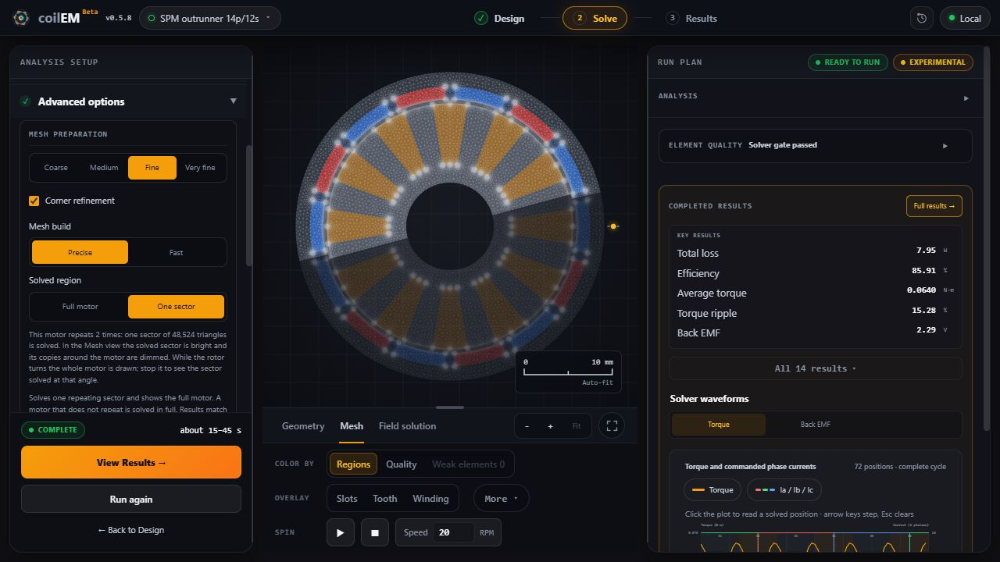
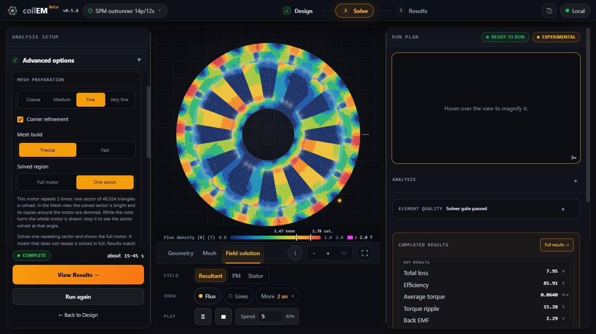

# PR #242: Windows sector validation at `52f19004`

Measured source: **`52f19004982887a7d615bbb8ea3b5a69bdfcacf7`**, in a clean, isolated worktree. Collection ran on November 15–16, 2026 (America/New_York). This branch adds validation evidence; the measured source identity remains the commit above.

**Result:** both A–F lanes, all sector tests, Rust tests, Prius checks, frontend build and Windows app checks passed. The unmodified full Python suite also exposed the Windows process-lookup failures detailed below, in addition to the 16 documented qualification outcomes.

## Machine and build

- Windows 11 Home, version 10.0.26200 (build 26200).
- AMD Ryzen 7 7700, 8 cores / 16 logical processors; 64 GB RAM; AC power.
- Python 3.13.9; Gmsh 4.15.2; NumPy 2.4.6; pytest 9.2.0; pytest-xdist 3.8.0.
- Rust / Cargo 1.95.0; Node 24.19.0. The branch's Magneto2D was built with `cargo build --release --locked` and no external binary override.
- [Machine details](machine.json), [toolchain](toolchain.log), [Python packages](python-environment.txt), [build log](cargo-build.log).

## Tests and app

| Check | Outcome |
| --- | --- |
| `tests/test_sector_symmetry.py` | **81 passed**; includes all 11 same-mesh sector/full exactness designs and all 4 stator-iron repetition designs |
| Rust release tests | **283 passed** |
| Full Python suite after dev setup, `-n auto` | **2,660 passed, 25 failed, 9 errors, 3 skipped** |
| Isolated Windows follow-up | **40 passed** |
| Frontend build, typechecks and contract checks | **PASS** |
| Windows app, SPM outrunner 14p/12s | **PASS** |

The app prepared a 1/2 sector with **48,524 solved / 97,048 displayed triangles**. Stator iron repeats by slot pitch, with tooth-centre mesh lines; the rotor has no equivalent lines. Stopped, the solved sector is bright and copies dimmed. Spin draws the whole motor; pausing restores the highlight at the current angle. The completed field and playback show the whole motor with no visible seam.





### Full-suite Windows failures

Of the 34 failure/error outcomes, **16 are the outcomes documented in the PR validation instructions**. The additional **18** are **14 failures in `test_performance_acceptance.py` and 4 setup errors in `test_qualification_publish.py`**, caused by bare-name `node` / `git` process lookup failing after Gmsh initialization.

A standalone reproduction imports no coilEM backend: before Gmsh, both bare and absolute executable names work; after `gmsh.initialize(); gmsh.finalize()`, bare `node` and `git` raise `FileNotFoundError: [WinError 2]`, while the same executables at absolute paths still work. This identifies a Windows executable-lookup issue independently of the sector numerical results.

Both affected test files plus the playback-shutdown follow-up passed in isolation (**40/40**). The first full run also had a playback-worker startup failure and teardown error; these cleared on the second full run and isolated follow-up. The first full run's results were 2,658 passed, 27 failed, 10 errors, 3 skipped. No application fix or test workaround was committed.

- Primary full run: [complete tracebacks](python-tests-dev.log), [JUnit XML](python-tests-dev.xml).
- First full run: [complete tracebacks](python-tests.log), [JUnit XML](python-tests.xml).
- Follow-up: [log](windows-followup.log), [JUnit XML](windows-followup.xml).
- Reproduction: [script](check_gmsh_executable_lookup.py), [result and tracebacks](gmsh-executable-lookup.json), [short log](gmsh-executable-lookup.log).

## A–F: full motor and sector, same build, back to back

| Lane | Numerical result | Native jobs | Observed wall time |
| --- | --- | --- | --- |
| Full motor, protocol 1.10.0 | **68 PASS + 1 planned UNSUPPORTED** | 74 complete + 1 unsupported | **33 min 18 s** |
| Sector, protocol 1.11.0 | **68 PASS + 1 planned UNSUPPORTED** | 74 complete + 1 unsupported | **17 min 2 s** |

All 68 supported sector cases used sectors, across all 74 native jobs: **zero full-motor fallbacks, zero status differences, zero native solver errors**. The unsupported row is the planned ORNL Prius HoleM50 row. No sector-edge pairing, curve-loop or mesh-quality errors occurred in the completed runs.

Sector wall time was **1.95× faster (about 49% less)**. These were sequential, same-machine, same-build observations on AC. Other development was taking place on the machine, so these are informational timings rather than controlled performance qualification.

Grading used the PR's requested wrapper to bypass **only** `references._require_cogging_review`; it did not modify the source checkout, reference bytes, grids, floors or gates. The outstanding geometry review and release qualification remain separate.

| Sector versus full motor | Maximum absolute difference |
| --- | ---: |
| Total stator iron loss, 29 cases | **0.8834%** |
| Yoke iron loss, 29 cases | **3.2172%** |
| Efficiency | **0.05624 percentage points** |
| Back-EMF fundamental | **0.10504%** |
| Registered λd / λq points, 12 cases | **0.00524% / 0.00706%** |
| Cogging peak-to-peak / fundamental, 12 cases | **5.2750% / 3.6089%** |

Loaded mean torque: **44 cases within 0.5%, 5 more within 1%, and 3 above 1%**. The three are the expected distributed Medium-mesh cases: 12p36s **+3.2531%**, 8p48s chorded **+1.6398%**, and 8p48s **+1.5459%**. Both lanes pass their FEMM gates for these cases.

Counts use actual request current: the legacy case named `spm_4p12s_simple_noload__high_current` requests 5 A, so there are 52 loaded cases in this comparison. The λd/λq percentages cover the 12 registered d/q gate points; other diagnostic linkages remain in the original summaries, including near-zero no-load q components.

- [Full-motor `benchmark_summary.json`](af-full-win/report/benchmark_summary.json).
- [Sector `benchmark_summary.json`](af-sector-win/report/benchmark_summary.json).
- [Case-by-case comparison CSV](full-vs-sector.csv), [comparison JSON](lane-comparison.json).

## Full motor against the published Windows 0.5.8 record

Compared with the Windows record measured at `78e6f4fc8aa8695c6f3ba1f4ad4eb9f843cf54f9`: **69/69 case comparisons match**, including every gate status. The suite and reference-bundle hashes are identical.

Maximum relative changes: mean torque **0.000153%**, Back-EMF fundamental **0.000004%**, cogging fundamental **0.00810%**, cogging peak-to-peak **0.00120%**, iron loss **0.00956%**. Maximum efficiency change is **0.000442 percentage points**. This is a numerical comparison; no qualification registry or carry receipt was updated.

[Detailed 0.5.8 comparison](v058-full-comparison.json).

## Prius, 1/8 sector

**17/17 jobs complete, all as 1/8 sectors; 10/10 software checks pass**, including all-field convergence, phase currents and source-linkage duality.

- Tutorial AB sampled RMS **107.491812 V**, **−0.06172%** from the retained tutorial.
- Loaded preset **353.999782 N·m**, **−0.26858%** from retained FEMM.
- All 13 curve means are within **0.118544 N·m** of the published Windows 0.5.8 full-motor run.
- Angular-64 control **353.994201 N·m** (−0.005581 N·m from normal-32).
- Fine-32 control **353.886855 N·m** (−0.112927 N·m from normal-32).

[`app-results.md`](prius-sector-win/report/app-results.md) · [`app-results.json`](prius-sector-win/report/app-results.json).

## Evidence and reproduction

- [All results and tracebacks in JSON](validation-results.json), [HTML report](validation-report.html), [collection status](validation-status.json).
- [Download reports and logs ZIP](pr242-windows-validation.zip).
- [Publication manifest](publication-manifest.json) records original and published SHA-256 hashes. Machine-local home-directory prefixes are replaced by `USER_HOME`, and native Windows-1252 logs are normalized to UTF-8; numerical values, requests, gate outcomes, measured identities and source/binary hash values are preserved. The original raw collection remains retained locally. Large native runtime/field archives are not in this report ZIP.
- The [analysis script](summarize_validation.py) preserves the local collection layout assumptions (`RUN/source` is the measured checkout; outputs are siblings). The published [grading wrapper](run_lane_local.py) removes only the completed orchestration readiness wait from the local wrapper and uses the same single review-guard bypass.

Reproduce from an isolated, clean checkout of the measured commit, with locked runtime and dev dependencies installed and the branch solver rebuilt. Keep the grading helper and output directories outside that checkout, as in the PR's Windows validation instructions:

```powershell
python -m pytest tests/test_sector_symmetry.py -q
cargo test --release --locked --manifest-path solvers/magneto2d/Cargo.toml
python -m pytest -q -n auto tests
python C:\path\run_lane_local.py . --suite benchmarks\af-v1.10\benchmark_spec.json --allow-dirty --out-dir C:\path\af-full-win
python C:\path\run_lane_local.py . --suite benchmarks\af-v1.11-sector\benchmark_spec.json --allow-dirty --out-dir C:\path\af-sector-win
python -m tools.benchmark_prius --out C:\path\prius-sector-win --curve --refinement --symmetry auto
python -m tools.report_prius_benchmark C:\path\prius-sector-win --out C:\path\prius-sector-win\report
```
