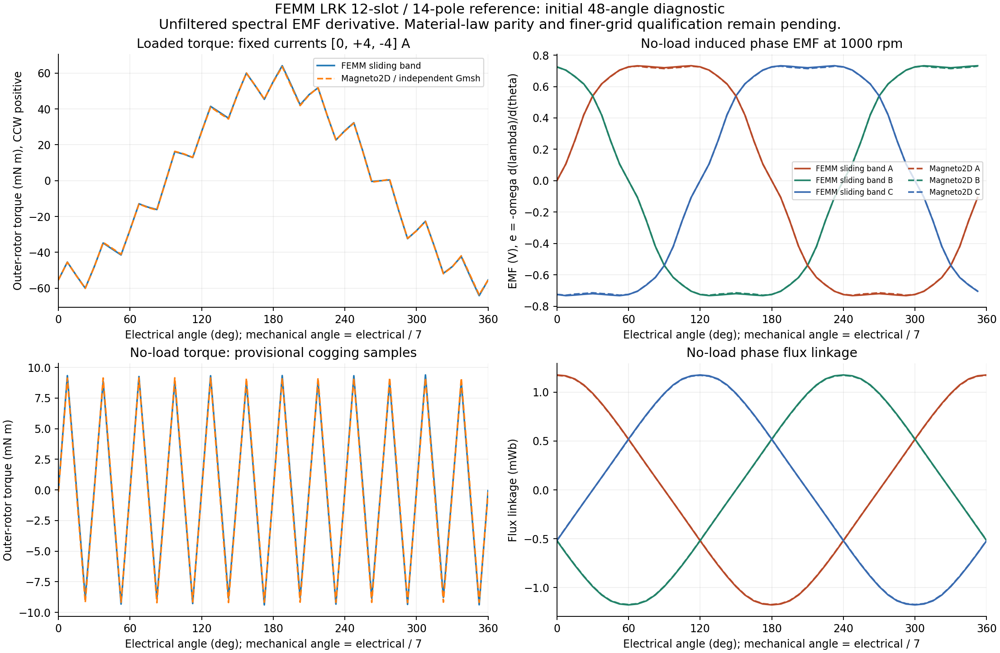

# Initial angle, torque and back-EMF comparison

Measured locally on 2026-11-05, from the exact `release/v0.5.1` base `cf6e8a90e4a33c34dc7ff81886e353b9950961d5`. These are software-comparison diagnostics. The complete preregistered qualification matrix is still open.

The first complete sweep contains **116 FEMM reference cases and 110 independent Gmsh/Magneto2D cases**. The six extra FEMM cases compare physical group-2 rotation against sliding-boundary outer-angle motion. Both curve families have 48 unique positions over 360/7 mechanical degrees, plus a separately solved repeated endpoint. Loaded currents are [0, +4, -4] A; the back-EMF sweep uses [0, 0, 0] A.

## Measured agreement

| Quantity | Initial result |
|---|---:|
| Loaded torque RMS difference / FEMM peak | 0.471% |
| Loaded torque maximum absolute difference | 0.6743 mN·m |
| Loaded phase-linkage relative L2 difference | 0.3704% |
| No-load phase-linkage relative L2 difference | 0.3526% |
| Back-EMF phase fundamental amplitude difference | -0.333% to -0.354% |
| Back-EMF phase fundamental phase difference | at most 0.0108 electrical degrees |
| Back-EMF line-to-line fundamental amplitude difference | -0.343% to -0.346% |
| Full phase back-EMF waveform relative L2 difference | 0.4396% |

At 1000 rpm, FEMM phase fundamental peaks are 0.83364–0.83374 V and Magneto2D peaks are 0.83079–0.83086 V. Line-to-line fundamental peaks are approximately 1.4440 V and 1.4390 V respectively. These are induced EMF values using `e = -omega_mechanical * d(lambda)/d(theta_mechanical)`, positive CCW. The source does not define the terminal connection, so this does not establish a terminal Kv rating.

The loaded torque curve keeps stator phase currents fixed while rotating the outer body. The signed torque consequently changes through the period. The numerical peaks sampled here are about +/-64.2 mN·m in FEMM and +/-63.7 mN·m in Magneto2D.

## Pointwise checks and open gates

| Angle, current [A,B,C] | FEMM physical-rotation WST (mN·m) | Native WST (mN·m) |
|---|---:|---:|
| -1/7°, [0,4,-4] | -57.7303 | -57.3489 |
| 0°, [0,4,-4] | -55.4274 | -55.4093 |
| +1/7°, [0,4,-4] | -53.5645 | -53.2389 |
| 5°, [0,4,-4] | -37.6901 | -37.2083 |
| 20°, [0,4,-4] | +33.6738 | +33.9530 |
| 40°, [0,4,-4] | -3.3944 | -3.5530 |
| 0°, [0,-6,6] | +82.9159 | +82.6710 |
| 0°, [0,-2,2] | +27.6362 | +27.4871 |
| 0°, [0,0,0] | -0.0649 | -0.1564 |
| 0°, [0,2,-2] | -27.7659 | -27.8036 |
| 0°, [0,6,-6] | -83.0470 | -83.0019 |

The loaded waveform, linkage and back-EMF fundamental metrics meet the proposed comparison limits at this initial grid. **The small static torques at 40° loaded and 0° no-load fail the proposed pointwise rule** `abs(error) <= max(2% * abs(reference), 0.05 mN·m)`. Do not summarize this as all points passing.

Reference discretization uncertainty is material here: at 5° the original FEMM physical-rotation WST and sliding integral differ by 0.8511 mN·m, while their phase linkages differ by no more than 0.00025 mWb. At 40° the two FEMM torque estimators differ by 0.0797 mN·m. Motion signs were checked without shifting angles, permuting phases or taking absolute torque values to improve agreement.

No-load torque is provisionally sampled at only four positions per cogging cycle on the initial electrical grid. Its relative L2 difference is 4.18%; the independent mesh has a small mean offset. Dedicated short-period spatial/angular convergence is still required. The plot joins actual samples and does not establish the detailed cogging shape.

## Numerical controls

- Gap mesh 0.05 to 0.025 mm at the original loaded point: native WST changes from -55.409276 to -55.311509 mN·m (about 0.176%); phase linkages change by less than 0.006%. Counts increase from 87,530/174,508 nodes/triangles to 212,890/425,228.
- Newton tolerance 1e-5 to 1e-6 at the same 0.05 mm point: torque changes by only 0.0000323 mN·m. This does not explain the small static torque discrepancies.
- Full spectral versus fourth-order periodic back-EMF derivative: relative waveform L2 differences are 0.194% (FEMM) and 0.240% (native). The spectral result retains every resolved mode; no harmonic cutoff or waveform fit is applied.
- A 96-angle no-load refinement and finer-mesh small-torque controls have been started. Record their completed results before making a refinement claim.
- Native steel laws retain the exact source B-H points with an explicitly named piecewise-linear effective law. FEMM spline-law parity has not been qualified. Do not adjust magnet strength or phase/torque scales to improve a match.

## Retained evidence and cleanup correction

Local raw evidence lives in `output/femm-outrunner-review/sweep48-femm/` and `sweep48-native/`. Each completed case retains its exact request, field/answer hashes and losslessly compressed raw fields. The complete derived CSVs and receipt are in `sweep48-analysis-complete/`. No large solver output is added to Git.

All 116 FEMM cases completed before its producer logged a COM/WMI cleanup error. The producer's final session JSON therefore remained `RUNNING`; it is not evidence of an unfinished solve. The old server PID 3244 was absent on recovery, and every reused answer/model archive was hash-verified before the refinement. The original log/session record is preserved. The process-inventory/cleanup code now runs outside the pyFEMM COM apartment, with exact PID and creation-identity checks; the refined producer must demonstrate a clean final shutdown before that correction is considered verified.

Sources: the original [FEMM Sliding Band Benchmark](https://www.femm.info/doku/doku.php?id=SlidingBandBenchmark) supplies the fixture and published point. The [pyFEMM manual](https://www.femm.info/doku/lib/exe/fetch.php?media=upload%3Apyfemm%3Apyfemm-manual.pdf) defines outer boundary angle property 11 and the extraction APIs. The values above are freshly measured local results.
