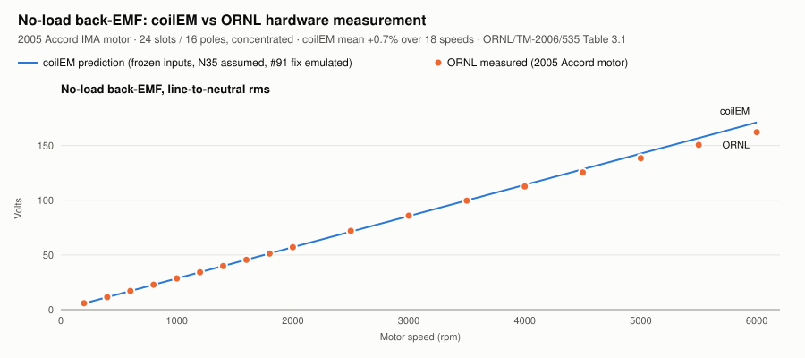
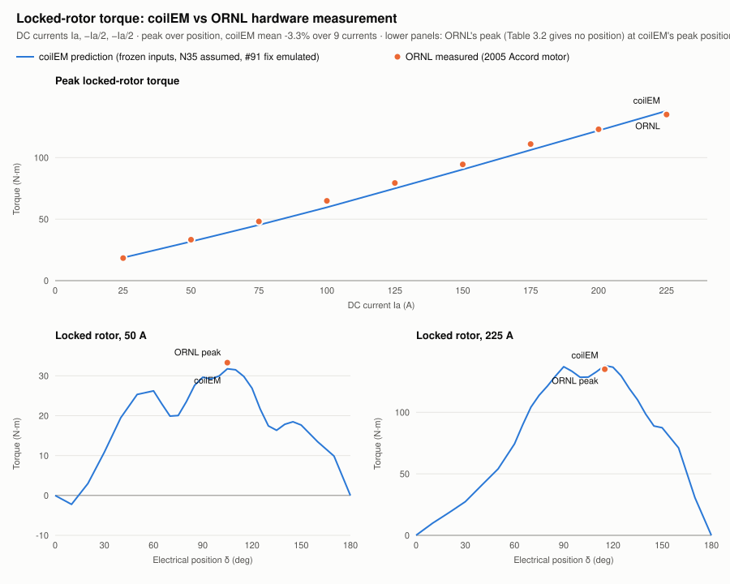

# First comparison with ORNL's hardware measurements

This compares coilEM's prediction for the 2005 Honda Accord hybrid motor with ORNL's measurements of the real motor (ORNL/TM-2006/535):
- **Inputs:** frozen in commit `1814bc6` ([Phase A](../README.md)).
- **Winding:** the **#91 tooth-coil fix emulated** (see the Phase A README).
- **Status:** an exploratory hardware correlation with no pass/fail, like #69. Nothing here was fitted.

Every solve ran on the clean commit `23799a5`, and `comparison.json` records each run's commit.

| File | What it holds |
| --- | --- |
| [`comparison.json`](comparison.json) | Every compared value, with the method and the run identities |
| [`no-load.json`](no-load.json) | coilEM's no-load back-EMF waveforms over one electrical cycle, for the tooth coils and for coilEM's slot map |
| [`locked-rotor.json`](locked-rotor.json) | The 198 locked-rotor static solves |
| [`back-emf.svg`](back-emf.svg), [`locked-rotor-torque.svg`](locked-rotor-torque.svg) | The charts |

Regenerate them with [`tools/honda_accord_comparison.py`](../../../../tools/honda_accord_comparison.py) and [`tools/plot_honda_accord_comparison.py`](../../../../tools/plot_honda_accord_comparison.py).

## No-load back-EMF

- **Source:** Table 3.1, line-to-neutral rms averaged over the three phases, at 18 speeds.
- **coilEM:** the tooth-coil phase back-EMF from one no-load sweep at 1000 rpm, as true rms over the cycle, scaled linearly with speed.

| Speed (rpm) | ORNL (V) | coilEM (V) | Error |
| --- | --- | --- | --- |
| 200 | 5.85 | 5.70 | −2.5% |
| 1,000 | 28.51 | 28.52 | +0.1% |
| 2,000 | 57.10 | 57.05 | −0.1% |
| 4,000 | 112.6 | 114.1 | +1.3% |
| 6,000 | 162.2 | 171.2 | +5.5% |
| All 18 speeds | | | mean **+0.7%** (−2.5% to +5.5%) |

- **High speed:** ORNL's measurement falls slightly below a straight line at the highest speeds; coilEM scales linearly.
- **Without the fix:** coilEM's current slot map would report 32.94 V rms at 1000 rpm instead of 28.52 V, **+15.5%**, the 2/√3 error #91 describes.

## Locked-rotor torque

- **Source:** Table 3.2, the peak torque over rotor position at each DC current, with the current pattern (Ia, −Ia/2, −Ia/2) assumed (A5).
- **coilEM:** a static solve every 5° electrical from δ = 60° to 150° at each current. δ = 0 is the no-torque position.

| Current | ORNL peak (N·m) | coilEM peak (N·m) | Error |
| --- | --- | --- | --- |
| 25 A | 18.3 | 18.7 | +1.9% |
| 50 A | 33.3 | 31.8 | −4.6% |
| 75 A | 48.1 | 45.3 | −5.9% |
| 100 A | 64.9 | 59.6 | −8.1% |
| 125 A | 79.4 | 74.9 | −5.6% |
| 150 A | 94.5 | 90.4 | −4.4% |
| 175 A | 111.0 | 106.2 | −4.3% |
| 200 A | 123.0 | 122.1 | −0.8% |
| 225 A | 135.0 | 138.0 | +2.2% |
| All 9 | | | mean **−3.3%** (−8.1% to +2.2%) |

- **Cogging:** coilEM predicts a large cogging torque, about 6.2 N·m peak, repeating every 60° electrical. It makes the peaks at low current sensitive to where the 5° grid falls relative to the rotor, which ORNL's report doesn't give.
- **The 225 A curve:** in the lower chart panel, its peak moves out to δ = 115°, beyond 90°, as reluctance torque grows.

Fitting each full curve to T = a sin δ + b sin 2δ (`magnet_reluctance_split`) gives:

| Current | Magnet term (N·m) | Reluctance term (N·m) | λpm (Wb) | Lq − Ld (µH) |
| --- | --- | --- | --- | --- |
| 50 A | 28.3 | −2.0 | 0.0472 | 130 |
| 125 A | 70.6 | −11.3 | 0.0471 | 120 |
| 225 A | 122.9 | −32.1 | 0.0455 | 106 |

The magnet term's λpm, 0.047 Wb, agrees with the back-EMF's 0.048 Wb.

## What this shows

- **Blind back-EMF lands within 1% on average,** with only N35 assumed and the winding emulated as real tooth coils. The fix #91 makes is the one that matters: without it, back-EMF is 15.5% high.
- **Blind torque is within −8% to +2% from 25 A to 225 A,** into the saturation ORNL reports above about 175 A. So magnet torque, reluctance torque and saturation all come out close on a concentrated-winding IPM.
- **The remaining differences fit the Phase A approximations:**
  - one flat magnet per pole, without the rib or the barriers between poles;
  - a bridge estimated from a photo;
  - the assumed steel;
  - the cogging sampling at low current.

  These are not fitted away.

When #91 lands, this case is re-run on the real fix. Any change from these numbers will be reported.
