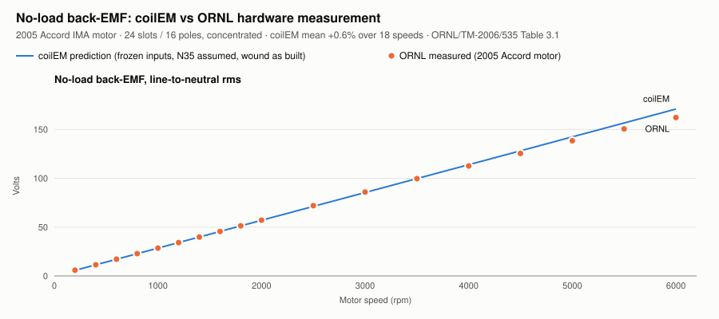
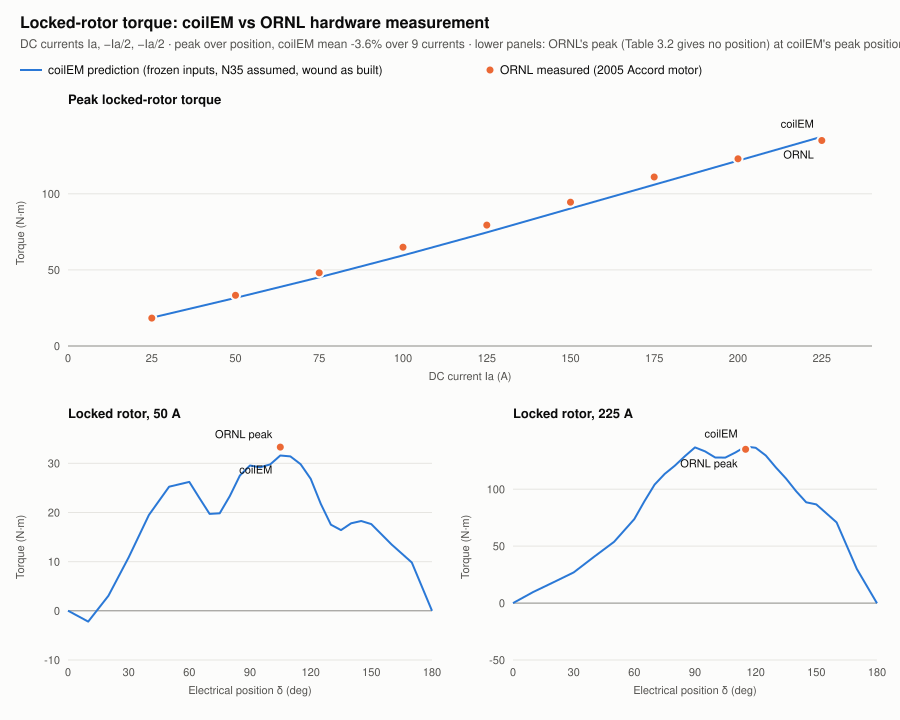

# Comparison with ORNL's hardware measurements, winding as built (#91)

This repeats the [first comparison](../first-comparison/README.md) on coilEM's fixed winding model. The first comparison emulated the #91 tooth coils on coilEM's old one-phase-per-slot map. This one winds the 2005 Honda Accord hybrid motor as it is built:

- **Inputs:** the frozen request from `1814bc6` ([Phase A](../README.md)), with only the winding changed to the real one.
  - **Winding as built:** a coil on every tooth, two layers per slot.
  - **Turns and paths:** 52 turns per coil, so 104 conductors per slot, with the 8 coils of each phase in parallel.
  - **Frozen request:** it carried the single-layer, one-path equivalent (13 conductors per slot) that the emulation needed.
  - **Series turns:** both windings put 52 turns in series per phase.
- **Excitation:** ORNL's DC pattern (Ia, −Ia/2, −Ia/2) applied directly. Every solve checked that its phase currents were exactly (1, −0.5, −0.5) × Ia.
- **Status:** an exploratory hardware correlation with no pass/fail. Nothing was fitted to ORNL's data.

| Run | Commit (clean) |
| --- | --- |
| No-load back-EMF | `738d951` |
| δ = 0 scan at 100 A | `738d951` |
| 198 locked-rotor solves | `50fe405` (no solver or backend change since `738d951`) |

| File | What it holds |
| --- | --- |
| [`comparison.json`](comparison.json) | Every compared value, with the method and the run identities |
| [`no-load.json`](no-load.json) | coilEM's phase back-EMF waveforms over one electrical cycle |
| [`zero-scan-100A.json`](zero-scan-100A.json) | The 30° rotor-offset scan at 100 A that locates δ = 0 |
| [`locked-rotor.json`](locked-rotor.json) | The 198 locked-rotor static solves |
| [`back-emf.svg`](back-emf.svg), [`locked-rotor-torque.svg`](locked-rotor-torque.svg) | The charts |

Regenerate them with [`tools/honda_accord_comparison.py`](../../../../tools/honda_accord_comparison.py) and [`tools/plot_honda_accord_comparison.py`](../../../../tools/plot_honda_accord_comparison.py).

## No-load back-EMF

| Speed (rpm) | ORNL (V) | coilEM (V) | Error |
| --- | --- | --- | --- |
| 200 | 5.85 | 5.70 | −2.6% |
| 1,000 | 28.51 | 28.48 | −0.1% |
| 2,000 | 57.10 | 56.96 | −0.2% |
| 4,000 | 112.6 | 113.9 | +1.2% |
| 6,000 | 162.2 | 170.9 | +5.4% |
| All 18 speeds | | | mean **+0.6%** (−2.6% to +5.4%) |

At 1000 rpm this gives 28.48 V rms, against 28.52 V for the emulation (−0.15%). Each coil side now links the field in its own half of the slot, where the emulation used the slot average.

## Locked-rotor torque

**Where δ = 0 sits.** δ = 0 is ORNL's no-torque position. As in the first comparison, it is located on coilEM's own 100 A cycle, where torque crosses zero rising.
- On the winding as built, it falls at a rotor offset of 300° electrical ([scan](zero-scan-100A.json)). The emulation's crossing was at 240°.
- Otherwise the curve is the same: the peak at 100 A is 59.5 N·m against the emulation's 59.6 N·m. The fixed solver simply labels the tooth coils' phases 60° away from the emulation's (A − B)/2 pairing.
- A first locked-rotor pass reused 240° by mistake and was discarded.

| Current | ORNL peak (N·m) | coilEM peak (N·m) | Error | Emulated (first comparison) |
| --- | --- | --- | --- | --- |
| 25 A | 18.3 | 18.6 | +1.4% | +1.9% |
| 50 A | 33.3 | 31.6 | −5.1% | −4.7% |
| 75 A | 48.1 | 45.1 | −6.2% | −5.9% |
| 100 A | 64.9 | 59.5 | −8.3% | −8.1% |
| 125 A | 79.4 | 74.6 | −6.0% | −5.6% |
| 150 A | 94.5 | 90.4 | −4.4% | −4.4% |
| 175 A | 111.0 | 105.9 | −4.5% | −4.3% |
| 200 A | 123.0 | 121.7 | −1.1% | −0.8% |
| 225 A | 135.0 | 137.5 | +1.8% | +2.2% |
| All 9 | | | mean **−3.6%** (−8.3% to +1.8%) | mean −3.3% |

- **Peak positions:** at every current the peak sits at the same δ as in the emulation.
- **Magnet/reluctance split:** at 125 A, λ_pm is 0.0469 Wb and Lq − Ld is 120.5 µH, against 0.0471 Wb and 120.0 µH emulated.

## What this shows

The fixed winding reproduces the emulated benchmark (#94) to within half a percent everywhere. That is what #91 asked of the app's Accord example. It also confirms that the emulation was a faithful stand-in for the real tooth coils.

The remaining differences from ORNL are the ones the first comparison discusses: the N35 assumption, the single-bar rotor, cogging at the 5° grid, and the high-speed back-EMF.
