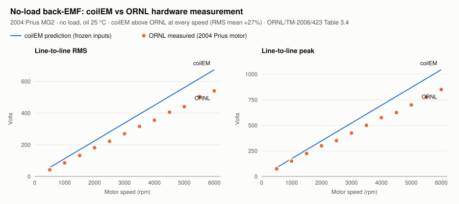
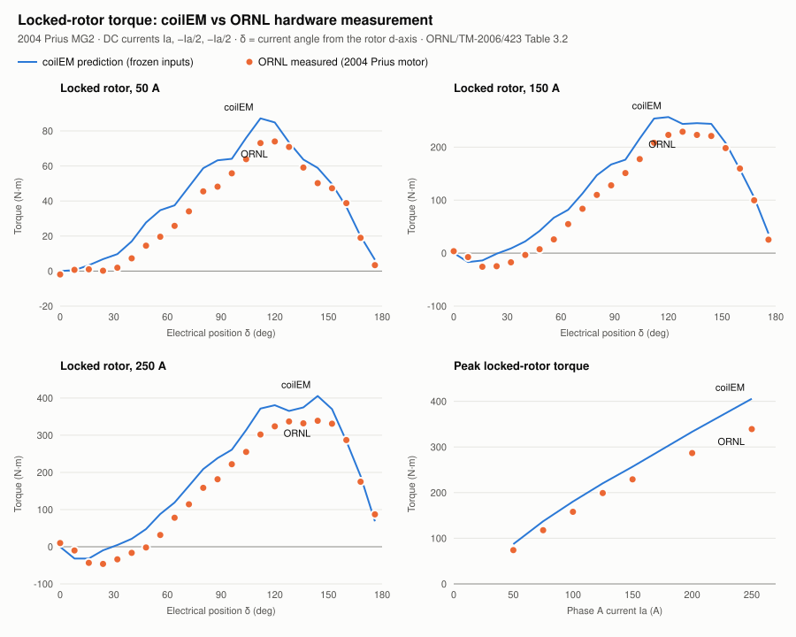

# First comparison with ORNL's hardware measurements

coilEM's prediction for the 2004 Prius motor, from the inputs frozen in commit `83231e0` ([fixture correction](../fixture-correction.md)), against ORNL's measurements of the real motor. It's an exploratory hardware correlation with no pass/fail, as [#69](https://github.com/coilemdev/coilem/issues/69) requires. Nothing here was fitted. The bands and the full Phase B report come separately.

| File | What it holds |
| --- | --- |
| [`comparison.json`](comparison.json) | Every compared value, plus the run identities |
| [`locked-rotor.json`](locked-rotor.json) | The 161 coilEM locked-rotor solves |
| [`back-emf.svg`](back-emf.svg), [`locked-rotor-torque.svg`](locked-rotor-torque.svg) | The charts |

Regenerate them with [`tools/ornl_prius_comparison.py`](../../../../tools/ornl_prius_comparison.py) and [`tools/plot_ornl_prius_comparison.py`](../../../../tools/plot_ornl_prius_comparison.py).

## No-load back-EMF

The source is ORNL/TM-2006/423 Table 3.4, line-to-line at the motor terminals, at 12 speeds. coilEM's line-to-line value is phase A minus phase B from the protocol 1.2.0 benchmark run, scaled linearly with speed.

| Speed (rpm) | ORNL RMS (V) | coilEM RMS (V) | Error | ORNL peak (V) | coilEM peak (V) | Error |
| --- | --- | --- | --- | --- | --- | --- |
| 502 | 42.0 | 56.4 | +34% | 75 | 87.4 | +16% |
| 1,999 | 181.6 | 224.5 | +24% | 300 | 347.9 | +16% |
| 3,501 | 315.7 | 393.1 | +25% | 500 | 609.3 | +22% |
| 5,998 | 539.8 | 673.5 | +25% | 850 | 1,043.9 | +23% |
| All 12 speeds | | | mean +27% | | | mean +21% |

## Locked-rotor torque

The source is ORNL/TM-2006/423 Table 3.2: DC currents Ia, −Ia/2, −Ia/2 with the rotor locked at 23 positions, for 7 currents.

coilEM reproduces the test with one static solve per point, on the frozen request with only the excitation and the rotor angle changed. δ = 0 is the no-torque position, ORNL's own definition, located on coilEM's own 50 A curve.

| Current | ORNL peak (N·m) | coilEM peak (N·m) | Error |
| --- | --- | --- | --- |
| 50 A | 74.0 | 87.2 | +18% |
| 100 A | 158.0 | 180.4 | +14% |
| 150 A | 229.0 | 256.7 | +12% |
| 200 A | 286.6 | 333.4 | +16% |
| 250 A | 339.0 | 405.5 | +20% |

ORNL's own reports disagree about the high-current peaks: Table 6.3 gives 400 N·m at 250 A against 339 N·m in Table 3.2 ([source audit](../source-audit.md)).

## Where the difference is

Torque splits into a magnet part ∝ sin δ and a reluctance part ∝ sin 2δ. Fitting both curves at each current (`magnet_reluctance_split` in `comparison.json`):

| Current | Magnet part, ORNL / coilEM | Difference | Reluctance part, ORNL / coilEM | Difference |
| --- | --- | --- | --- | --- |
| 50 A | 53.1 / 65.7 N·m | +24% | −26.9 / −24.3 N·m | −10% |
| 100 A | 107.3 / 130.6 N·m | +22% | −72.7 / −68.1 N·m | −6% |
| 150 A | 151.6 / 188.1 N·m | +24% | −115.7 / −111.9 N·m | −3% |
| 250 A | 222.3 / 280.5 N·m | +26% | −183.4 / −185.0 N·m | +1% |

- **The magnet flux linkage is about 24% high, and only that.** ORNL's no-load back-EMF, the magnet part of ORNL's torque, and ORNL's airgap probe (about 0.75 T peak, ORNL/TM-2004/137 Fig. 13) all give a magnet flux linkage of about 0.17–0.18 Wb. coilEM gives 0.218 Wb, with an airgap fundamental of 0.91 T.
- **The reluctance part matches.** Lq − Ld agrees from 3.6 down to 1.0 mH as the steel saturates. So the geometry, steel and slotting are right.
- **The 9 turns per coil are effectively confirmed.** Reluctance torque scales with turns squared: 8 turns would leave it 21% low.
- **ORNL's undefined "Scaled" back-EMF header isn't the cause.** The torque shows the same 24% without going through that column.
- **coilEM's magnetic model looks physically sound.** The magnets operate at 1.12 T, rotor leakage is 16.5%, and the bridges saturate.

That leaves the magnet inputs, which were read from figures or assumed:
- Br, 1.235 T, extrapolated from a demagnetization plot with no test temperature;
- magnet size, which fills the whole pocket in the model;
- the magnets' axial length, assumed equal to the stack;
- the magnets' condition in a used motor.

A coilEM numerical error on this rotor is ruled out only by the matched FEMM run (#82); the reluctance agreement argues against one. Phase B carries these as bands. Any model changed after this comparison is `fitted — not a prediction`.
