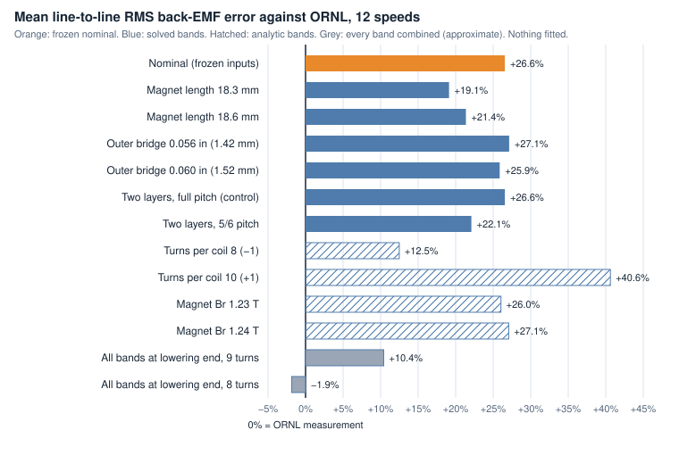

# ORNL 2004 Prius: Phase B no-load back-EMF report (v1)

This is Phase B of [#69](https://github.com/coilemdev/coilem/issues/69). It compares coilEM's no-load back-EMF for the 2004 Toyota Prius traction motor with ORNL's measurements, and bounds the comparison with the input uncertainties the [source audit](source-audit.md) lists.

It is an **exploratory hardware correlation with no pass/fail**. It uses the experimental HoleM50 rotor path, makes no qualification claim, and changes no qualification wording. Nothing in it is fitted.

| File | What it holds |
| --- | --- |
| [`phase-b/comparison.json`](phase-b/comparison.json) | Every compared value: the run identity, each case at the 12 measured speeds, the combined envelopes, the flux-linkage and crest-factor comparisons |
| [`phase-b/requests/`](phase-b/requests/) | The six band requests: the frozen request with exactly one sourced change each |
| [`phase-b/bands.svg`](phase-b/bands.svg) | The chart below |

## Result

**coilEM's back-EMF is 27% above ORNL's, and the documented input uncertainties do not explain it.**

- **Nominal prediction.** From the inputs frozen in `83231e0`, the line-to-line RMS back-EMF is 26.6% above ORNL's on average (+22.7% to +34.2% over 12 speeds) and the peak is 20.9% above. Re-solved at `d60802c`, it is identical to the [first comparison](first-comparison/README.md) at every speed.
- **Each sourced band moves it by 6% or less, except the turn count.**
  - Magnet length at the measured seat lowers it by 5.9% (18.3 mm) or 4.1% (18.6 mm).
  - The bridge callouts move it by under 0.6%.
  - A 5/6 short pitch lowers it by 3.5%.
  - The Br read-off moves it by 0.4%.
  - One turn less or more moves it by 11%.
- **Every band at its lowering end** still leaves the RMS 10.4% high with the inferred 9 turns. Only with 8 turns as well does it reach −1.9%. The peak does come down to ORNL's (−4.6% with 9 turns), but mostly through the 5/6 pitch, which then makes the waveform shape disagree with ORNL's (see [Waveform shape](#waveform-shape)). The [first comparison's](first-comparison/README.md) locked-rotor torque argues against 8 turns: reluctance torque scales with turns squared, and 8 turns would leave it 21% low where 9 match.
- **The excess is in the magnet flux linkage.** coilEM gives λpm = 218.4 mWb; ORNL's measurements imply 173.0 mWb, so coilEM's is 1.26 times ORNL's. The waveform shapes agree: the peak-to-RMS ratio is 1.55 in coilEM and 1.54–1.62 in ORNL's data above 2,500 rpm.

So either an input outside the audit's bounds is wrong (the magnets' Br at the test temperature, their condition in a used motor, or their axial length), or coilEM misses something on this rotor. The matched FEMM reference ([#82](https://github.com/coilemdev/coilem/issues/82)) is what separates the two. Until it exists, this report doesn't attribute the gap.

## Blindness

The model inputs were frozen in `83231e0`, before any comparison with ORNL's measurements ([fixture correction](fixture-correction.md#input-freeze)). This report adds no fitted case.

It is **not blind to the size of the gap**. The [first comparison](first-comparison/README.md) was published before this report. Also, during the HoleM50 work ([#70](https://github.com/coilemdev/coilem/issues/70)), a coarse smoke solve was once compared with ORNL's target before the freeze; that comparison wasn't recorded, and the owner was told.

To keep the bands from becoming a fit, they come only from the audit's gap list, and each runs at the endpoints its source gives. The report shows every endpoint, not the best-fitting one.

## The bands

| Band | Source | Endpoints | How |
| --- | --- | --- | --- |
| Magnet length | Phase A measured the straight magnet-seat edge at 18.3–18.6 mm; HoleM50 models it notch to notch, 19.30 mm ([HoleM50 mapping](holem50-mapping.md#magnet-length)) | 18.3 and 18.6 mm (`holem50_w4_mm`) | Solved |
| Outer bridge | The lamination drawing's two callouts, 0.056 and 0.060 in; the model uses their mean, 1.47 mm | 1.42 and 1.52 mm (`holem50_h1_mm`) | Solved |
| Coil pitch | The audit assumes full pitch and names 5/6 as the alternative | 5/6 pitch, against a two-layer full-pitch control | Solved |
| Turns per coil | 9, inferred from TM-2005/33 Fig. 24 | 8 and 10 | Back-EMF is proportional to turns at no load |
| Magnet Br | Read off a demagnetization plot as 1.23–1.24 T; the model uses 1.235 T | 1.23 and 1.24 T | Taken as proportional |
| End effects | 2D at the 83.82 mm stack; the audit allows 1–3% | −3% | Allowance, used only in the combined envelopes |

A short pitch needs two layers. coilEM winds a two-layer distributed winding with the same 8 coils per phase and conductors per slot as one layer, so the two-layer full-pitch control reproduces the nominal to 0.01%. The 5/6-pitch case is compared with that control.

A first pitch pair was solved with two parallel paths on the wrong assumption that two layers double the coils. Its back-EMF came out exactly half, as two paths imply. Its 5/6-to-full ratio, 0.9659, matches the pair reported here. That pair isn't published.

### Not solved; stated

- **Steel grade.** The audit asks for two 0.35 mm grades. Magneto2D has one steel curve, M350-50A (0.5 mm), and no sourced curve for another grade is available. Not run.
- **Magnet temperature.** Assumed equal to the 25 °C oil. Br falls about 0.1% for each kelvin warmer; ORNL recorded no magnet temperature.
- **Skew.** Assumed none. S4's rotor photographs were not inspected for skew. A skew would lower the fundamental by about 1–2%.
- **Magnet condition.** The tested motor was used, and its magnets' condition is unknown.
- **Winding layout.** Single-layer full pitch, q = 2, is assumed; the pitch band covers the alternative the audit names.



## Results by case

Each row is the mean over ORNL's 12 speeds. The change against the nominal is the same at every speed, because no-load back-EMF scales linearly with speed.

| Case | How | RMS against nominal | Peak against nominal | RMS error vs ORNL | Peak error vs ORNL | λpm (mWb) |
| --- | --- | --- | --- | --- | --- | --- |
| Nominal (frozen inputs) | Solved | — | — | +26.6% | +20.9% | 218.4 |
| Magnet length 18.3 mm | Solved | −5.87% | −7.00% | +19.1% | +12.4% | 205.7 |
| Magnet length 18.6 mm | Solved | −4.10% | −4.96% | +21.4% | +14.9% | 209.5 |
| Outer bridge 0.056 in (1.42 mm) | Solved | +0.45% | +0.50% | +27.1% | +21.5% | 219.4 |
| Outer bridge 0.060 in (1.52 mm) | Solved | −0.54% | +0.08% | +25.9% | +21.0% | 217.2 |
| Two layers, full pitch (control) | Solved | +0.01% | +0.01% | +26.6% | +20.9% | 218.4 |
| Two layers, 5/6 pitch | Solved | −3.53% | −12.25% | +22.1% | +6.1% | 211.0 |
| Turns per coil 8 (−1) | Analytic | −11.11% | −11.11% | +12.5% | +7.5% | — |
| Turns per coil 10 (+1) | Analytic | +11.11% | +11.11% | +40.6% | +34.3% | — |
| Magnet Br 1.23 T | Analytic | −0.40% | −0.40% | +26.0% | +20.4% | — |
| Magnet Br 1.24 T | Analytic | +0.40% | +0.40% | +27.1% | +21.4% | — |

The combined envelopes take every band at its lowering endpoint, together with the −3% end-effect allowance, and multiply them. Interactions are ignored, so they are approximate.

| Envelope | RMS error vs ORNL | Peak error vs ORNL |
| --- | --- | --- |
| All bands, 9 turns | +10.4% | −4.6% |
| All bands, 8 turns | −1.9% | −15.2% |

## Nominal prediction by speed

| Speed (rpm) | ORNL RMS (V) | coilEM RMS (V) | Error | ORNL peak (V) | coilEM peak (V) | Error |
| --- | --- | --- | --- | --- | --- | --- |
| 502 | 42.0 | 56.4 | +34.2% | 75 | 87.4 | +16.5% |
| 1,000 | 85.7 | 112.3 | +31.0% | 150 | 174.0 | +16.0% |
| 1,502 | 132.3 | 168.7 | +27.5% | 225 | 261.4 | +16.2% |
| 1,999 | 181.6 | 224.5 | +23.6% | 300 | 347.9 | +16.0% |
| 2,501 | 221.8 | 280.8 | +26.6% | 350 | 435.3 | +24.4% |
| 2,999 | 269.3 | 336.7 | +25.0% | 425 | 521.9 | +22.8% |
| 3,501 | 315.7 | 393.1 | +24.5% | 500 | 609.3 | +21.9% |
| 3,999 | 354.6 | 449.0 | +26.6% | 575 | 696.0 | +21.0% |
| 4,501 | 405.5 | 505.4 | +24.6% | 625 | 783.4 | +25.3% |
| 4,999 | 440.4 | 561.3 | +27.5% | 700 | 870.0 | +24.3% |
| 5,500 | 503.4 | 617.6 | +22.7% | 775 | 957.2 | +23.5% |
| 5,998 | 539.8 | 673.5 | +24.8% | 850 | 1,043.9 | +22.8% |

## Conversion chain

ORNL's numbers and coilEM's come from different instruments and conventions. Each step:

1. **ORNL's values** are ORNL/TM-2006/423 Table 3.4, which is identical to TM-2004/247 Table 3.4.
   - The headers say "Scaled back-emf" without defining the scaling. The owner accepted (2026-10-14) that the values are line-to-line volts at the motor terminals, as S1 Fig. 13 labels the same data "Voltage (LL)".
   - Each speed has an RMS and a peak column. The oil was at a nominal 25 °C.
2. **Speed.** The table's motor-shaft speed is the axle speed times 4.114, because ORNL welded the differential. It is consistent row by row:
   - the axle-to-motor ratio is 4.113–4.115 at every speed;
   - the table's electrical frequency matches 4 pole pairs × shaft speed within ±1.5%.

   The motor-shaft column is used directly.
3. **coilEM's waveform.** The phase back-EMF is line-to-neutral, solved at 3,000 rpm with 48 samples per electrical period.
4. **Line-to-line.** Phase A minus phase B, sample by sample.
5. **RMS and peak.**
   - RMS is over one electrical period.
   - Peak is the largest sampled absolute value, so a narrow harmonic peak between samples can be missed.
6. **Speed scaling.** No-load back-EMF is scaled linearly from 3,000 rpm to each measured speed. coilEM models no iron-loss effect on it.

The same conversion is `no_load_back_emf_line_to_line` in [`tools/benchmark_suite/hardware.py`](../../../tools/benchmark_suite/hardware.py), which the benchmark row uses.

## Flux linkage

ORNL's measurements imply a magnet flux linkage if the back-EMF is taken as sinusoidal: λ = √2 · E_LL,rms / √3 / ω_e. Over the 12 speeds this gives 173.0 mWb on average (163.1–178.4 mWb). The two lowest values come from the two slowest speeds.

coilEM's nominal λpm is 218.4 mWb, so Ke = 4 · λpm = 0.874 V·s/rad. The [first comparison](first-comparison/README.md#where-the-difference-is) finds the same excess, about 24%, in the magnet part of ORNL's locked-rotor torque. The reluctance part matches there.

## Waveform shape

ORNL's back-EMF traces (S1 Fig. 14) exist only as images, so this report compares no waveforms point by point. The peak-to-RMS ratio stands in for the harmonic content:

- ORNL's is 1.54–1.62 from 2,500 rpm up.
- It is higher at the slowest speeds (1.79 at 502 rpm). ORNL gives every peak in steps of 25 V, which is coarse at 75 V.
- coilEM's nominal is 1.55 at every speed.

Full pitch keeps that agreement. The 5/6-pitch case suppresses the 5th and 7th harmonics and drops coilEM's ratio to 1.41, away from ORNL's. The waveform shape therefore mildly favours the assumed full pitch.

## What comes next

- **Matched FEMM reference (#82).** The owner's Windows FEMM run on the same HoleM50 geometry. If FEMM agrees with coilEM, the gap is in the inputs, most likely the magnets. If it agrees with ORNL, coilEM misses something on this rotor.
- **A fitted variant.** Only after that, and labelled `fitted — not a prediction`, could one ask what magnet Br would close the gap.

## Reproduce

Each case solves with the experimental tool from a clean checkout at `d60802c`:

```sh
python -m tools.experimental_solve --config docs/hardware-validation/ornl-prius-2004/phase-b/requests/magnet-length-18.3.json --output magnet-length-18.3.json
```

- The nominal case uses the frozen request, [`benchmarks/abcd-v1.2/fixtures/ornl_prius_2004_ipm.json`](../../../benchmarks/abcd-v1.2/fixtures/ornl_prius_2004_ipm.json).
- `no_load_back_emf_line_to_line(record["result"], record["request"], target)` turns each result into the rows above, where `target` is [`target-back-emf.json`](target-back-emf.json).
- Each solve took 2 to 8 minutes on an Apple M4, and needed about 0.5 GB of solver cache (1.6 GB for 5/6 pitch, which has no symmetry to reuse).
- The Magneto2D binary's SHA-256 is in `phase-b/comparison.json`.
